<!-- This file is generated by scripts/build.py from data/milestones.yaml. Edit the YAML, not this file. -->
# AI Milestones

**A sourced, illustrated timeline of the moments artificial intelligence crossed a line** — from the first theorem-proving program to Deep Blue, AlphaGo, AlphaStar, protein folding and olympiad gold.

**85 milestones** · 1950–2026 · every entry cites at least two sources · data last changed 2026-10-20 · last reviewed for new milestones 2026-10-20

 

> [!NOTE]
> This timeline is kept up to date automatically: a scheduled review looks for new milestones every week, and every source link is checked weekly. See [MAINTAINING.md](MAINTAINING.md) for how entries are chosen and verified.

## Contents

- [Humans vs. machines](#humans-vs-machines) — every contest that pitted an AI directly against human experts
- [1950s](#1950s) (6)
- [1960s](#1960s) (2)
- [1970s](#1970s) (5)
- [1980s](#1980s) (4)
- [1990s](#1990s) (5)
- [2000s](#2000s) (6)
- [2010s](#2010s) (19)
- [2020s](#2020s) (38)
- [How this repo works](#how-this-repo-works)

**Categories:** ♟️ Games & competitions (27) · 🧮 Mathematics, code & reasoning (23) · 🔬 Science (5) · 👁️ Vision & speech (5) · 💬 Language (9) · 🤖 Robotics & autonomy (9) · 🧱 Foundations (7)

## Humans vs. machines

Every entry where an AI system was measured directly against human experts. Most are AI wins; a few are draws, narrow losses or simulated contests — each entry says which.

| Year | Arena | AI system | Human opponent(s) |
|---|---|---|---|
| 1962 | [Checkers](#samuel-checkers-nealey) | Samuel Checkers (Arthur L. Samuel, IBM) | Robert Nealey, self-described checkers master |
| 1979 | [Medical diagnosis (expert systems)](#mycin-meningitis-evaluation) | MYCIN (Edward Shortliffe, Bruce Buchanan, Stanley Cohen et al., Stanford University) | Five Stanford faculty, an infectious-disease fellow, a resident and a medical student (plus the actual therapy given) |
| 1979 | [Backgammon](#bkg-backgammon-villa) | BKG 9.8 (Hans Berliner, Carnegie Mellon University) | Luigi Villa, newly crowned backgammon world champion |
| 1988 | [Chess](#deep-thought-beats-grandmaster) | Deep Thought (Feng-hsiung Hsu, Thomas Anantharaman, Murray Campbell, Andreas Nowatzyk, Mike Browne; Carnegie Mellon University) | Bent Larsen, chess grandmaster and former world-championship candidate |
| 1992 | [Backgammon](#td-gammon-self-play) | TD-Gammon (Gerald Tesauro, IBM Research) | Bill Robertie and other top backgammon players (exhibition games) |
| 1994 | [Checkers](#chinook-man-machine-champion) | Chinook (Jonathan Schaeffer and team, University of Alberta) | Marion Tinsley, world checkers champion (withdrew after six drawn games) |
| 1997 | [Chess](#deep-blue-kasparov) | Deep Blue (IBM Research: Feng-hsiung Hsu, Murray Campbell, Joe Hoane, Jerry Brody, C. J. Tan; GM Joel Benjamin as adviser) | Garry Kasparov, reigning world chess champion |
| 1997 | [Othello](#logistello-murakami) | Logistello (Michael Buro, NEC Research Institute) | Takeshi Murakami, reigning Othello world champion |
| 2008 | [Poker (heads-up limit Texas hold'em)](#polaris-limit-holdem-pros) | Polaris (University of Alberta Computer Poker Research Group) | Team of limit hold'em pros incl. Matt Hawrilenko, IJay Palansky, Nick Grudzien, Kyle Hendon |
| 2011 | [Question answering (Jeopardy!)](#watson-jeopardy) | Watson / DeepQA (IBM Research, team led by David Ferrucci) | Ken Jennings and Brad Rutter, Jeopardy!'s two most successful champions |
| 2016 | [Go](#alphago-lee-sedol) | AlphaGo (Google DeepMind) | Lee Sedol, 9-dan professional and 18-time world title winner |
| 2017 | [Poker (heads-up no-limit hold'em)](#libratus-no-limit-holdem) | Libratus (Carnegie Mellon University; Tuomas Sandholm and Noam Brown) | Jason Les, Dong Kim, Daniel McAulay and Jimmy Chou, top heads-up no-limit professionals |
| 2017 | [Shogi](#ponanza-beats-meijin) | Ponanza (Issei Yamamoto and Hiroshi Shimozumi) | Amahiko Sato, reigning Meijin |
| 2017 | [Go](#alphago-ke-jie) | AlphaGo Master (Google DeepMind) | Ke Jie, world No. 1 ranked Go player |
| 2019 | [StarCraft II](#alphastar-beats-starcraft-pros) | AlphaStar (DeepMind) | Dario "TLO" Wünsch and Grzegorz "MaNa" Komincz, Team Liquid professionals |
| 2019 | [Dota 2](#openai-five-beats-og) | OpenAI Five (OpenAI) | OG, reigning The International 2018 Dota 2 world champions |
| 2019 | [Poker](#pluribus-six-player-poker) | Pluribus (Carnegie Mellon University and Facebook AI) | Elite professional poker players, including Chris Ferguson and Darren Elias |
| 2019 | [StarCraft II](#alphastar-grandmaster) | AlphaStar Final (DeepMind) | Ranked human players on the European Battle.net ladder |
| 2020 | [Air combat (simulation)](#alphadogfight-trials) | Heron Systems AI agent (DARPA Air Combat Evolution program) | Experienced USAF F-16 pilot "Banger", trained at the USAF Weapons School |
| 2022 | [Competitive programming](#alphacode-competitive-programming) | AlphaCode (DeepMind) | Human participants in 10 Codeforces contests (simulated evaluation) |
| 2022 | [Sim racing (Gran Turismo Sport)](#gran-turismo-sophy) | Gran Turismo Sophy (Sony AI, with Polyphony Digital and Sony Interactive Entertainment) | Four of the world's top Gran Turismo esports drivers (Race Together 2021) |
| 2022 | [Diplomacy](#cicero-diplomacy) | Cicero (Meta AI, FAIR Diplomacy team) | Human players in an anonymous online webDiplomacy.net blitz league |
| 2023 | [Drone racing](#swift-drone-racing-champions) | Swift (University of Zurich Robotics and Perception Group, with Intel Labs) | Alex Vanover, Thomas Bitmatta and Marvin Schaepper, champion FPV drone-racing pilots |
| 2024 | [Olympiad mathematics](#alphaproof-imo-2024-silver) | AlphaProof and AlphaGeometry 2 (Google DeepMind) | Human contestants at the 65th IMO (Bath, UK) |
| 2025 | [Turing test](#gpt-4-5-turing-test) | GPT-4.5 (OpenAI), tested by Jones and Bergen (UC San Diego) | Human witnesses and interrogators in a randomized three-party Turing test |
| 2025 | [Competitive programming (heuristic optimization)](#atcoder-world-tour-finals-heuristic-2025) | Unreleased OpenAI model/agent (OpenAI also sponsored the event) | Przemysław "Psyho" Dębiak and the other human finalists |
| 2025 | [Olympiad mathematics](#imo-2025-gold-medal-ai) | Gemini Deep Think, advanced version (Google DeepMind); experimental reasoning model (OpenAI) | Human contestants at the 66th IMO |
| 2025 | [Competitive programming (olympiad)](#ioi-2025-openai-gold) | Ensemble of OpenAI general-purpose reasoning models | About 330 human contestants at IOI 2025 |
| 2025 | [Competitive programming (collegiate)](#icpc-2025-world-finals-ai) | OpenAI (GPT-5 + experimental reasoning model); Google DeepMind (Gemini 2.5 Deep Think) | 139 university teams at the 2025 ICPC World Finals |
| 2026 | [Stratego](#ataraxos-stratego-superhuman) | Ataraxos (Carnegie Mellon, MIT, NYU, Stanford) | Pim Niemeijer, four-time Stratego world champion |

## Timeline

### 1950s

<table><tr>
<td width="300" valign="top"> Possibly Arthur Reginald Chaffin (1893-1954) · Public domain · <a href="https://commons.wikimedia.org/wiki/File:Alan_Turing_Aged_16.jpg">Wikimedia Commons</a></td>
<td valign="top">

#### 🧱 Turing publishes "Computing Machinery and Intelligence"
**October 1950** · 🧱 Philosophy of AI · *Alan Turing (University of Manchester)*

In the October 1950 issue of the journal Mind (vol. 59, no. 236, pp. 433-460), Alan Turing proposed swapping the vague question "Can machines think?" for a concrete test, the "imitation game", in which an interrogator tries to tell a machine from a human over text. The paper also answers a list of objections to machine intelligence and argues that a learning "child machine" that is then educated may be the most practical route there.

**Why it matters:** It gave the field its first operational benchmark (the Turing test) and framed the research agenda years before the term "artificial intelligence" existed.

**Sources:** [I.—Computing Machinery and Intelligence](https://doi.org/10.1093/mind/LIX.236.433) (Mind (Oxford University Press)) · [Computing Machinery and Intelligence](https://en.wikipedia.org/wiki/Computing_Machinery_and_Intelligence) (Wikipedia)

</td></tr></table>

<table><tr>
<td width="300" valign="top" align="center"><i>No freely licensed image yet</i></td>
<td valign="top">

#### ♟️ Strachey's draughts program plays a full game on the Ferranti Mark 1
**1952** · ♟️ Draughts (checkers) · *Draughts program by Christopher Strachey (Ferranti Mark 1, University of Manchester)*

Christopher Strachey wrote a draughts program in May 1951 for the NPL's Pilot ACE. It failed when first run there on 30 July 1951, so he rewrote it for the larger-memory Manchester machine. By summer 1952 it could play a complete game against a human at a reasonable speed. It is generally counted among the first game-playing programs. Dietrich Prinz's Ferranti Mark 1 chess program, which first ran in November 1951, only solved mate-in-two problems.

**Why it matters:** One of the earliest programs to play a whole board game, and the starting point for Arthur Samuel's checkers work at IBM.

**Sources:** [What is Artificial Intelligence? (AlanTuring.net reference articles)](https://alanturing.net/turing_archive/pages/Reference%20Articles/what_is_AI/What%20is%20AI04.html) (AlanTuring.net (Turing Archive for the History of Computing, B. J. Copeland)) · [Christopher Strachey](https://en.wikipedia.org/wiki/Christopher_Strachey) (Wikipedia)

</td></tr></table>

<table><tr>
<td width="300" valign="top" align="center"><i>No freely licensed image yet</i></td>
<td valign="top">

#### 💬 Georgetown-IBM experiment gives first public machine-translation demo
**January 7, 1954** · 💬 Machine translation · *Georgetown-IBM system (Georgetown University: Leon Dostert, Paul Garvin; IBM 701)*

At IBM's New York headquarters on 7 January 1954, Georgetown University and IBM had an IBM 701 translate more than sixty Russian sentences into English (Hutchins counts 61). The system used a vocabulary of about 250 words and stems and just six syntax rules. The event made front-page news, and organizers and press forecast that practical machine translation was three to five years away.

**Why it matters:** It was the first public demonstration of machine translation, and it set off both MT funding and the field's first hype cycle. The ALPAC report cut that funding in 1966.

**Sources:** [The first public demonstration of machine translation: the Georgetown-IBM system, 7th January 1954](http://www.hutchinsweb.me.uk/GU-IBM-2005.pdf) (John Hutchins (2005/2006)) · [Georgetown–IBM experiment](https://en.wikipedia.org/wiki/Georgetown%E2%80%93IBM_experiment) (Wikipedia)

</td></tr></table>

<table><tr>
<td width="300" valign="top" align="center"><i>No freely licensed image yet</i></td>
<td valign="top">

#### 🧮 Logic Theorist proves theorems from Principia Mathematica
**June 15, 1956** · 🧮 Theorem proving · *Logic Theorist (Allen Newell, Herbert A. Simon, J. C. Shaw; RAND Corporation)*

Allen Newell, Herbert Simon and Cliff Shaw at RAND built the Logic Theorist, a program that searches for proofs in propositional logic using heuristics rather than brute force. It was first hand-simulated on index cards in January 1956. It went on to prove 38 of the first 52 theorems in Chapter 2 of Whitehead and Russell's Principia Mathematica, and for theorem 2.85 it found a proof shorter than the one in the book.

**Why it matters:** Often called the first artificial intelligence program, it showed a machine doing work that had been seen as uniquely human: discovering mathematical proofs.

**Sources:** [The Logic Theory Machine: A Complex Information Processing System (RAND P-868)](https://www.rand.org/pubs/papers/P868.html) (RAND Corporation) · [The logic theory machine–A complex information processing system (IRE Transactions on Information Theory, IT-2(3), 1956)](https://ieeexplore.ieee.org/document/1056797) (IEEE Xplore) · [Logic Theorist](https://en.wikipedia.org/wiki/Logic_Theorist) (Wikipedia)

</td></tr></table>

<table><tr>
<td width="300" valign="top"><a href="https://commons.wikimedia.org/wiki/File:A_Proposal_for_the_Dartmouth_Summer_Research_Project_on_Artificial_Intelligence,_by_John_McCarthy_et_al,_1955.pdf">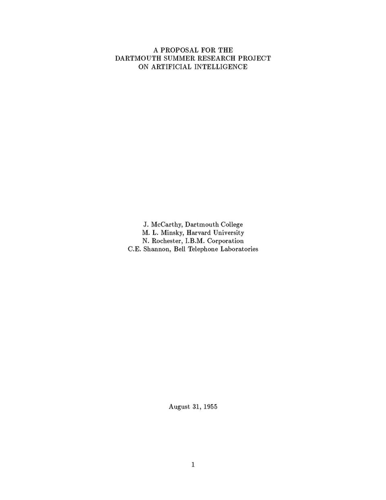</a> John McCarthy et al · Public domain · <a href="https://commons.wikimedia.org/wiki/File:A_Proposal_for_the_Dartmouth_Summer_Research_Project_on_Artificial_Intelligence,_by_John_McCarthy_et_al,_1955.pdf">Wikimedia Commons</a></td>
<td valign="top">

#### 🧱 Dartmouth workshop launches "artificial intelligence" as a field
**June 18, 1956** · 🧱 AI research · *Dartmouth Summer Research Project on Artificial Intelligence (McCarthy, Minsky, Rochester, Shannon)*

John McCarthy, Marvin Minsky, Nathaniel Rochester and Claude Shannon put the phrase "artificial intelligence" into a funding proposal dated 31 August 1955, for a two-month study built on the conjecture that every aspect of learning and intelligence could in principle be described precisely enough for a machine to simulate. The resulting summer project ran at Dartmouth College in Hanover, New Hampshire, roughly from 18 June to 17 August 1956.

**Why it matters:** It named the field and brought together the researchers who led it for the next two decades.

**Sources:** [A Proposal for the Dartmouth Summer Research Project on Artificial Intelligence, August 31, 1955 (AI Magazine 27(4), 2006 reprint)](https://ojs.aaai.org/index.php/aimagazine/article/view/1904) (AAAI / AI Magazine) · [Dartmouth workshop](https://en.wikipedia.org/wiki/Dartmouth_workshop) (Wikipedia)

</td></tr></table>

<table><tr>
<td width="300" valign="top" align="center"><i>No freely licensed image yet</i></td>
<td valign="top">

#### 🧱 Rosenblatt's perceptron learns to recognize patterns
**July 1958** · 🧱 Neural networks · *Perceptron / Mark I Perceptron (Frank Rosenblatt, Cornell Aeronautical Laboratory; funded by ONR)*

In July 1958 the U.S. Office of Naval Research unveiled Frank Rosenblatt's perceptron. A simulation running on an IBM 704 at the Cornell Aeronautical Laboratory taught itself, after about 50 trials, to tell punch cards marked on the left from cards marked on the right. The theory appeared in Psychological Review that year. The custom Mark I Perceptron hardware followed: a 20x20 grid of 400 photosensors wired at random to 512 association units, with learned weights stored in motor-driven potentiometers.

**Why it matters:** It was the first machine to learn a classification from examples, and it is the direct ancestor of today's neural networks.

**Sources:** [Professor's perceptron paved the way for AI – 60 years too soon](https://news.cornell.edu/node/313946) (Cornell Chronicle) · [Mark I Perceptron Operators' Manual (Project PARA), Report VG-1196-G-5, 15 Feb 1960](https://apps.dtic.mil/sti/tr/pdf/AD0236965.pdf) (Cornell Aeronautical Laboratory (via DTIC)) · [The perceptron: a probabilistic model for information storage and organization in the brain](https://pubmed.ncbi.nlm.nih.gov/13602029/) (Psychological Review (PubMed record)) · [Perceptron](https://en.wikipedia.org/wiki/Perceptron) (Wikipedia)

</td></tr></table>

<a href="#contents">↑ back to contents</a>

### 1960s

<table><tr>
<td width="300" valign="top" align="center"><i>No freely licensed image yet</i></td>
<td valign="top">

#### ♟️ Samuel's self-taught checkers program beats Robert Nealey
**1962** · ♟️ Checkers · *Samuel Checkers (Arthur L. Samuel, IBM)* vs. *Robert Nealey, self-described checkers master*

Arthur Samuel's IBM checkers program improved partly by playing thousands of games against itself and learning from positions it had seen. In 1962 it won a single game against Robert Nealey, whom IBM billed as a former Connecticut champion and one of the nation's top players. Samuel's 1959 IBM Journal paper described the learning methods behind it.

**Why it matters:** It was the first widely publicized win by a machine-learning program over a strong human player, which made "a computer that learns" a public idea.

**Sources:** [The games that helped AI evolve](https://www.ibm.com/history/early-games) (IBM History) · [Some Studies in Machine Learning Using the Game of Checkers (IBM J. Res. Dev. 3(3), 1959)](https://doi.org/10.1147/rd.33.0210) (IBM Journal of Research and Development)

</td></tr></table>

<table><tr>
<td width="300" valign="top"> Unknown author · Public domain · <a href="https://commons.wikimedia.org/wiki/File:ELIZA_conversation.png">Wikimedia Commons</a></td>
<td valign="top">

#### 💬 Weizenbaum's ELIZA becomes the first chatbot
**January 1966** · 💬 Conversational agents · *ELIZA (Joseph Weizenbaum, MIT)*

Joseph Weizenbaum at MIT wrote ELIZA in MAD-SLIP for the CTSS time-sharing system on an IBM 7094. It matched keywords in typed input and reassembled them into replies according to a script. Its best-known script, DOCTOR, imitated a Rogerian psychotherapist by reflecting the user's words back as questions. Weizenbaum described it in Communications of the ACM in January 1966.

**Why it matters:** The first program people could hold a free-form text conversation with. Its users readily credited it with understanding, which gave its name to the "ELIZA effect".

**Sources:** [ELIZA—a computer program for the study of natural language communication between man and machine (CACM 9(1):36-45)](https://doi.org/10.1145/365153.365168) (Communications of the ACM) · [ELIZA Reanimated: The world's first chatbot restored on the world's first time sharing system](https://arxiv.org/abs/2501.06707) (arXiv (Lane, Hay, Schwarz, Berry, Shrager, 2025)) · [ELIZA](https://en.wikipedia.org/wiki/ELIZA) (Wikipedia)

</td></tr></table>

<a href="#contents">↑ back to contents</a>

### 1970s

<table><tr>
<td width="300" valign="top" align="center"><i>No freely licensed image yet</i></td>
<td valign="top">

#### 💬 SHRDLU converses in English about a simulated blocks world
**February 1971** · 💬 Natural language understanding · *SHRDLU (Terry Winograd, MIT AI Laboratory)*

Terry Winograd built SHRDLU at the MIT AI Lab between 1968 and 1970, running on a PDP-6 with a graphics display of a small world of blocks, pyramids and a box. Users typed English commands and questions. The program moved objects, answered questions about the scene and its own actions, said when it didn't know a word, and could learn new terms such as "steeple" from a definition. It was published as MIT AI Technical Report 235 and in 1972 as the book "Understanding Natural Language".

**Why it matters:** It was the most convincing language-understanding demonstration of its era, tying parsing, meaning and action together, though only inside a tiny closed world.

**Sources:** [Procedures as a Representation for Data in a Computer Program for Understanding Natural Language (MIT AI TR-235)](https://dspace.mit.edu/handle/1721.1/7095) (MIT DSpace) · [SHRDLU](https://en.wikipedia.org/wiki/SHRDLU) (Wikipedia)

</td></tr></table>

<table><tr>
<td width="300" valign="top"> SRI International · <a href="https://creativecommons.org/licenses/by-sa/3.0">CC BY-SA 3.0</a> · <a href="https://commons.wikimedia.org/wiki/File:SRI_Shakey_with_callouts.jpg">Wikimedia Commons</a></td>
<td valign="top">

#### 🤖 SRI's Shakey becomes the first mobile robot to reason about its actions
**1972** · 🤖 Mobile robotics / planning · *Shakey (SRI Artificial Intelligence Center: Charles Rosen, Nils Nilsson, Peter Hart, Bertram Raphael et al.)*

From 1966 to 1972, SRI's Artificial Intelligence Center built Shakey, a wheeled robot with a TV camera and touch sensors, with funding from DARPA. A large remote computer handled its processing over a radio link. Given typed English commands, it could perceive its rooms, plan a route around obstacles and push blocks into place. The project produced the A* search algorithm (1968), a practical Hough transform for line detection (1972) and the STRIPS planner.

**Why it matters:** It was the first robot to combine perception, planning and action in one physical system, and its algorithms are still used in navigation, games and vision today.

**Sources:** [Shakey the Robot](https://sri.com/hoi/shakey-the-robot) (SRI International) · [Shakey (Revolution: Artificial Intelligence & Robotics)](https://www.computerhistory.org/revolution/artificial-intelligence-robotics/13/289) (Computer History Museum) · [Milestones:SHAKEY: The World's First Mobile Intelligent Robot, 1972](https://ethw.org/Milestones:SHAKEY:_The_World’s_First_Mobile_Intelligent_Robot,_1972) (IEEE / Engineering and Technology History Wiki) · [Shakey the robot](https://en.wikipedia.org/wiki/Shakey_the_robot) (Wikipedia)

</td></tr></table>

<table><tr>
<td width="300" valign="top" align="center"><i>No freely licensed image yet</i></td>
<td valign="top">

#### 🔬 MYCIN out-prescribes Stanford experts in a blinded meningitis test
**1979** · 🔬 Medical diagnosis (expert systems) · *MYCIN (Edward Shortliffe, Bruce Buchanan, Stanley Cohen et al., Stanford University)* vs. *Five Stanford faculty, an infectious-disease fellow, a resident and a medical student (plus the actual therapy given)*

MYCIN, built at Stanford in the 1970s by Edward Shortliffe with Bruce Buchanan and Stanley Cohen, chose antibiotics for serious infections using about 600 if-then rules and backward-chaining inference. In a study published in JAMA in 1979, it prescribed for 10 difficult meningitis cases alongside five Stanford faculty, an infectious-disease fellow, a resident and a student. Eight outside infectious-disease specialists graded every prescription without knowing its source, and rated 65% of MYCIN's acceptable, against 42.5-62.5% for the faculty.

**Why it matters:** In a landmark blinded comparison, a rule-based program performed as well as or better than medical specialists, the high point of the expert-system approach that DENDRAL had started in the 1960s.

**Sources:** [An Evaluation of MYCIN's Advice (Ch. 31 of Buchanan & Shortliffe, Rule-Based Expert Systems, 1984; edited from JAMA 242:1279-1282, 1979)](https://people.dbmi.columbia.edu/~ehs7001/Buchanan-Shortliffe-1984/Chapter-31.pdf) (Columbia DBMI (book chapter hosted by E. H. Shortliffe)) · [Yu et al., MYCIN meningitis therapy evaluation, JAMA 242:1279-1282 (1979)](https://doi.org/10.1001/jama.1979.03300120033020) (JAMA) · [Mycin](https://en.wikipedia.org/wiki/Mycin) (Wikipedia) · [Dendral](https://en.wikipedia.org/wiki/Dendral) (Wikipedia)

</td></tr></table>

<table><tr>
<td width="300" valign="top" align="center"><i>No freely licensed image yet</i></td>
<td valign="top">

#### 🤖 Stanford Cart crosses a chair-filled room on its own
**1979** · 🤖 Robot navigation / stereo vision · *Stanford Cart (Hans Moravec, Stanford Artificial Intelligence Laboratory)*

The Stanford Cart began in the early 1960s as a remote-driving testbed and was later taken over by the Stanford AI Lab. Hans Moravec rebuilt it in 1977 and added stereo vision: a camera sliding on a rail took pictures from several angles, from which a computer estimated the distance to obstacles and planned a path around them. In 1979 the cart crossed a chair-filled room without human help, moving in short hops with long pauses to process images and replan.

**Why it matters:** It was an early demonstration of a robot navigating unknown clutter using only computer vision, and it formed the basis of Moravec's 1980 PhD thesis.

**Sources:** [Stanford Cart (The Computer Museum slide series: Robots)](https://www.computerhistory.org/collections/catalog/102723520) (Computer History Museum) · [Hans Moravec](https://en.wikipedia.org/wiki/Hans_Moravec) (Wikipedia)

</td></tr></table>

<table><tr>
<td width="300" valign="top"><a href="https://commons.wikimedia.org/wiki/File:Backgammon_lg.jpg">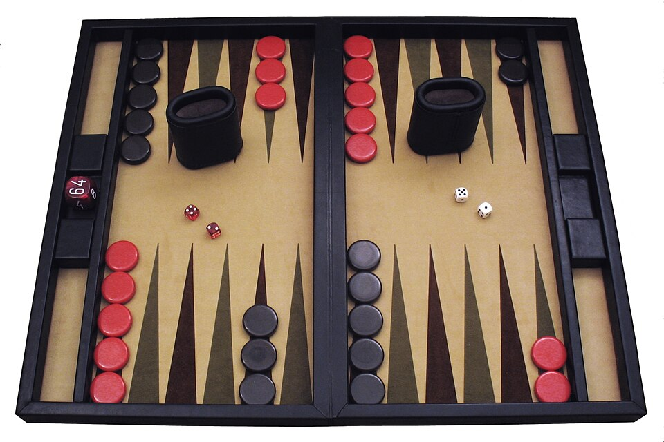</a> Ptkfgs · Public domain · <a href="https://commons.wikimedia.org/wiki/File:Backgammon_lg.jpg">Wikimedia Commons</a></td>
<td valign="top">

#### ♟️ BKG 9.8 beats backgammon world champion Luigi Villa 7-1
**July 1979** · ♟️ Backgammon · *BKG 9.8 (Hans Berliner, Carnegie Mellon University)* vs. *Luigi Villa, newly crowned backgammon world champion*

In July 1979 in Monte Carlo, the day after Luigi Villa won the backgammon world championship, Hans Berliner's program BKG 9.8 played him a $5,000 winner-take-all match to 7 points and won 7-1. The program evaluated positions with smoothly varying weighted features instead of rigid rules. Berliner later admitted that it had the better of the dice and that Villa played better.

**Why it matters:** Its creator described it as the first time a computer program beat a reigning world champion at any board or card game.

**Sources:** [Computer Backgammon (Scientific American 242(6), June 1980, pp. 64-72; reproduced)](https://bkgm.com/articles/Berliner/ComputerBackgammon/) (Hans Berliner / bkgm.com) · [BKG 9.8 (Hans Berliner)](https://en.wikipedia.org/wiki/BKG_9.8) (Wikipedia) · [Luigi Villa](https://en.wikipedia.org/wiki/Luigi_Villa) (Wikipedia)

</td></tr></table>

<a href="#contents">↑ back to contents</a>

### 1980s

<table><tr>
<td width="300" valign="top"><a href="https://commons.wikimedia.org/wiki/File:Geoffrey_Hinton_at_UBC.jpg">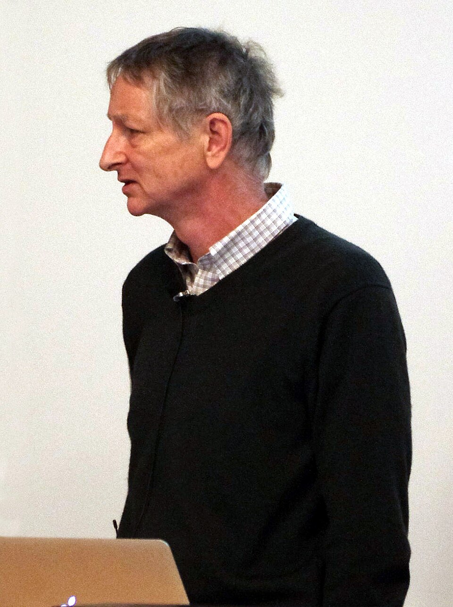</a> Eviatar Bach · <a href="https://creativecommons.org/licenses/by-sa/3.0">CC BY-SA 3.0</a> · <a href="https://commons.wikimedia.org/wiki/File:Geoffrey_Hinton_at_UBC.jpg">Wikimedia Commons</a></td>
<td valign="top">

#### 🧱 Rumelhart, Hinton and Williams popularize backpropagation
**October 1986** · 🧱 Neural networks · *Backpropagation (David Rumelhart, Geoffrey Hinton, Ronald Williams)*

In "Learning representations by back-propagating errors" (Nature 323:533-536, 1986), David Rumelhart, Geoffrey Hinton and Ronald Williams showed that passing error gradients backward through a multilayer network lets its hidden units learn useful internal features on their own. Their experiments got past the single-layer limits that had stalled perceptron research.

**Why it matters:** It made gradient-trained multilayer networks practical and popular, and it underlies essentially all of modern deep learning.

**Sources:** [Learning representations by back-propagating errors (Nature 323(6088):533-536)](https://doi.org/10.1038/323533a0) (Nature) · [Backpropagation](https://en.wikipedia.org/wiki/Backpropagation) (Wikipedia)

</td></tr></table>

<table><tr>
<td width="300" valign="top" align="center"><i>No freely licensed image yet</i></td>
<td valign="top">

#### ♟️ Deep Thought becomes first computer to beat a grandmaster in a tournament game
**1988** · ♟️ Chess · *Deep Thought (Feng-hsiung Hsu, Thomas Anantharaman, Murray Campbell, Andreas Nowatzyk, Mike Browne; Carnegie Mellon University)* vs. *Bent Larsen, chess grandmaster and former world-championship candidate*

At the 1988 Software Toolworks Championship in Los Angeles, Carnegie Mellon's Deep Thought defeated grandmaster Bent Larsen, a former world-title contender, in a regular tournament game. It tied for first with GM Tony Miles at 6.5/8. The result lifted its USCF rating to 2551 and qualified it for the $10,000 Fredkin Intermediate Prize, the first 2500-level performance by a computer over 25 straight games against humans.

**Why it matters:** It was the first time a machine beat a grandmaster under normal tournament conditions, and the team went on to IBM to build Deep Blue.

**Sources:** [Deep Thought Wins Fredkin Intermediate Prize (AI Magazine 10(2), Summer 1989)](https://ojs.aaai.org/aimagazine/index.php/aimagazine/article/download/753/671/0) (Hans Berliner / AAAI AI Magazine) · [Deep Thought (chess computer)](https://en.wikipedia.org/wiki/Deep_Thought_(chess_computer)) (Wikipedia) · [Bent Larsen](https://en.wikipedia.org/wiki/Bent_Larsen) (Wikipedia) · [Deep Thought](https://www.chessprogramming.org/Deep_Thought) (Chessprogramming wiki)

</td></tr></table>

<table><tr>
<td width="300" valign="top" align="center"><i>No freely licensed image yet</i></td>
<td valign="top">

#### 🤖 ALVINN neural network learns to steer CMU's Navlab van
**1989** · 🤖 Autonomous driving · *ALVINN on Navlab 1 (Dean Pomerleau, Carnegie Mellon University Robotics Institute)*

Dean Pomerleau's ALVINN was a three-layer network trained with backpropagation. It took a 30x32 camera image plus a laser rangefinder input, mapped them through 29 hidden units, and output one of 45 steering directions. It was trained first on simulated road images. On Carnegie Mellon's Navlab 1 van it followed a wooded path, and it set a speed record of 1.3 m/s in March 1989. By June 1989 it could learn to follow a road from about ten minutes of watching a human drive.

**Why it matters:** It was one of the first vehicles steered by a neural network that learned to drive from examples, an early form of the end-to-end approach used in self-driving research today.

**Sources:** [ALVINN: An Autonomous Land Vehicle in a Neural Network (NIPS 1, 1988)](https://proceedings.neurips.cc/paper/1988/hash/812b4ba287f5ee0bc9d43bbf5bbe87fb-Abstract.html) (Advances in Neural Information Processing Systems) · [Navlab](https://en.wikipedia.org/wiki/Navlab) (Wikipedia) · [Look, Ma, No Hands! (1995 Navlab 5 cross-country trip retrospective)](https://www.cmu.edu/news/stories/archives/2015/july/look-ma-no-hands.html) (Carnegie Mellon University)

</td></tr></table>

<table><tr>
<td width="300" valign="top"><a href="https://commons.wikimedia.org/wiki/File:MnistExamples.png">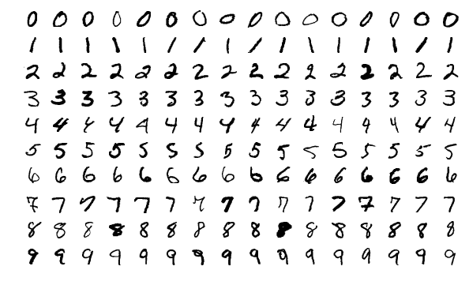</a> Josef Steppan · <a href="https://creativecommons.org/licenses/by-sa/4.0">CC BY-SA 4.0</a> · <a href="https://commons.wikimedia.org/wiki/File:MnistExamples.png">Wikimedia Commons</a></td>
<td valign="top">

#### 👁️ LeCun's convolutional network reads handwritten ZIP codes
**December 1989** · 👁️ Handwriting recognition · *Convolutional network, later named LeNet (Yann LeCun, Bernhard Boser, John Denker, Donnie Henderson, Richard Howard, Wayne Hubbard, Lawrence Jackel; AT&T Bell Labs)*

At AT&T Bell Labs, Yann LeCun and colleagues trained a convolutional neural network end to end with backpropagation, learning shared-weight feature detectors directly from pixels. The data were 9,298 handwritten digit images (16x16) cut from ZIP codes on mail passing through the Buffalo, NY post office, split 7,291 for training and 2,007 for testing. They published the work in Neural Computation (vol. 1, no. 4) in December 1989. Humans averaged about 2.5% error on the same test set.

**Why it matters:** It set out the convolutional-network design behind modern computer vision, and its descendants were reading about 10% of U.S. checks by around 2001.

**Sources:** [Backpropagation Applied to Handwritten Zip Code Recognition (Neural Computation 1(4):541-551)](https://doi.org/10.1162/neco.1989.1.4.541) (Neural Computation (MIT Press)) · [LeNet](https://en.wikipedia.org/wiki/LeNet) (Wikipedia)

</td></tr></table>

<a href="#contents">↑ back to contents</a>

### 1990s

<table><tr>
<td width="300" valign="top"> see Wikimedia Commons · <a href="https://commons.wikimedia.org/wiki/File:Backgammon_board.jpg">Wikimedia Commons</a></td>
<td valign="top">

#### ♟️ TD-Gammon teaches itself near-world-class backgammon through self-play
**1992** · ♟️ Backgammon · *TD-Gammon (Gerald Tesauro, IBM Research)* vs. *Bill Robertie and other top backgammon players (exhibition games)*

Gerald Tesauro at IBM's T. J. Watson Research Center trained a neural network to play backgammon using temporal-difference learning, TD(lambda). It learned mostly from games against itself, plus a set of hand-designed input features. Version 2.0 had trained on about 800,000 self-play games and searched 2 ply. It made its debut at the 1992 World Cup of Backgammon, where it played 38 exhibition games against top players and lost by a net 7 points. Version 2.1, after about 1.5 million self-play games, played Bill Robertie over 40 games and finished only 1 point behind.

**Why it matters:** It was the first striking evidence that reinforcement learning by self-play could reach near-expert human strength in a complex game. Its move choices changed how human experts played certain opening rolls.

**Sources:** [TD-Gammon, A Self-Teaching Backgammon Program, Achieves Master-Level Play](https://research.ibm.com/publications/td-gammon-a-self-teaching-backgammon-program-achieves-master-level-play) (IBM Research (AAAI Fall Symposium 1993)) · [TD-Gammon, a Self-Teaching Backgammon Program, Achieves Master-Level Play (Neural Computation 6(2):215-219, 1994; DOI 10.1162/neco.1994.6.2.215)](https://mlanthology.org/neco/1994/tesauro1994neco-tdgammon) (ML Anthology / Neural Computation) · [Temporal Difference Learning and TD-Gammon (Communications of the ACM 38(3), March 1995)](https://bkgm.com/articles/tesauro/tdl.html) (bkgm.com (reprint of Tesauro's CACM article)) · [TD-Gammon](https://en.wikipedia.org/wiki/TD-Gammon) (Wikipedia)

</td></tr></table>

<table><tr>
<td width="300" valign="top"> see Wikimedia Commons · <a href="https://commons.wikimedia.org/wiki/File:Marion_Tinsley.jpg">Wikimedia Commons</a></td>
<td valign="top">

#### ♟️ Chinook becomes Man-Machine World Checkers Champion
**August 18, 1994** · ♟️ Checkers · *Chinook (Jonathan Schaeffer and team, University of Alberta)* vs. *Marion Tinsley, world checkers champion (withdrew after six drawn games)*

The 1994 Man vs. Machine World Checkers Championship was held at the Computer Museum in Boston, starting on 15 August. It was a rematch between Marion Tinsley, who had beaten Chinook 4-2 with 33 draws in 1992, and the University of Alberta program led by Jonathan Schaeffer. The first six games were all drawn. On 18 August Tinsley resigned the match and the title for health reasons, and the organizers declared Chinook champion. Chinook then drew a 20-game match with Don Lafferty 1-1, and it defended the title again in 1995.

**Why it matters:** This was the first time a computer program held a human world championship title in a game of skill.

**Sources:** [1994 Man vs. Machine World Championship (match description)](https://webdocs.cs.ualberta.ca/~chinook/matches/1994/Boston/Tinsley/description.php) (University of Alberta, Chinook project) · [CHINOOK The World Man-Machine Checkers Champion (AI Magazine 17(1), 1996)](https://ojs.aaai.org//index.php/aimagazine/article/view/1208) (AAAI / AI Magazine) · [Marion Tinsley](https://en.wikipedia.org/wiki/Marion_Tinsley) (Wikipedia)

</td></tr></table>

<table><tr>
<td width="300" valign="top"> see Wikimedia Commons · <a href="https://commons.wikimedia.org/wiki/File:1966-HerbertRobbins.jpg">Wikimedia Commons</a></td>
<td valign="top">

#### 🧮 Automated prover EQP settles the 60-year-old Robbins conjecture
**October 10, 1996** · 🧮 Boolean algebra · *EQP equational theorem prover (William McCune, Argonne National Laboratory)*

In the 1930s Herbert Robbins asked whether commutativity, associativity and a single "Robbins equation" are enough to axiomatize Boolean algebra. Edward Huntington, Alfred Tarski and others tried and failed to settle it. On 10 October 1996, EQP, an equational theorem prover written by William McCune at Argonne National Laboratory, found a proof that the answer is yes. The successful search ran for about 8 days on an IBM RS/6000 and used about 30 MB of memory.

**Why it matters:** A computer program, with no human proof sketch to follow, produced the first solution to a well-known open problem that leading mathematicians had worked on for decades.

**Sources:** [Robbins Algebras Are Boolean](https://www.cs.unm.edu/~mccune/papers/robbins/) (William McCune (Argonne National Laboratory), hosted at University of New Mexico) · [Solution of the Robbins Problem (Journal of Automated Reasoning 19(3):263-276, 1997)](https://link.springer.com/article/10.1023/A:1005843212881) (Springer) · [Robbins algebra](https://en.wikipedia.org/wiki/Robbins_algebra) (Wikipedia) · [Robbins Conjecture](https://mathworld.wolfram.com/RobbinsConjecture.html) (Wolfram MathWorld)

</td></tr></table>

<table><tr>
<td width="300" valign="top"> see Wikimedia Commons · <a href="https://commons.wikimedia.org/wiki/File:Deep_Blue.jpg">Wikimedia Commons</a></td>
<td valign="top">

#### ♟️ IBM's Deep Blue defeats world chess champion Garry Kasparov
**May 11, 1997** · ♟️ Chess · *Deep Blue (IBM Research: Feng-hsiung Hsu, Murray Campbell, Joe Hoane, Jerry Brody, C. J. Tan; GM Joel Benjamin as adviser)* vs. *Garry Kasparov, reigning world chess champion*

In February 1996 in Philadelphia, Deep Blue beat Kasparov in game 1, the first game a computer had won against a reigning world champion at classical time controls, but Kasparov took the match 4-2. In the May 1997 rematch at New York's Equitable Center, an upgraded Deep Blue lost game 1 and won game 2. Games 3-5 were drawn, and Deep Blue won game 6 on 11 May to take the match 3.5-2.5. The IBM team was led by Feng-hsiung Hsu and Murray Campbell. Their parallel system used custom chess chips and could examine about 200 million positions per second.

**Why it matters:** This was the first time a computer defeated a reigning world chess champion in a match under standard tournament conditions, a goal AI researchers had pursued since the 1950s.

**Sources:** [Deep Blue](https://www.ibm.com/history/deep-blue) (IBM (IBM History)) · [Deep Blue versus Garry Kasparov](https://en.wikipedia.org/wiki/Deep_Blue_versus_Garry_Kasparov) (Wikipedia) · [IBM Deep Blue Team (Joe Hoane, Joel Benjamin, Jerry Brody, Feng-Hsiung Hsu, C.J. Tan, and Murray Campbell)](https://www.computerhistory.org/chess/stl-431e1a07a3881/) (Computer History Museum)

</td></tr></table>

<table><tr>
<td width="300" valign="top"> see Wikimedia Commons · <a href="https://commons.wikimedia.org/wiki/File:Othello-Standard-Board.jpg">Wikimedia Commons</a></td>
<td valign="top">

#### ♟️ Logistello sweeps Othello world champion Takeshi Murakami 6-0
**August 7, 1997** · ♟️ Othello · *Logistello (Michael Buro, NEC Research Institute)* vs. *Takeshi Murakami, reigning Othello world champion*

From 4 to 7 August 1997, Michael Buro's Othello program Logistello played reigning world champion Takeshi Murakami in a six-game match at the NEC Research Institute in Princeton, New Jersey. Logistello won all six games. The match was sponsored by NECI, with prizes of $3,000 and $1,000, and the games were broadcast live online with expert commentary.

**Why it matters:** The shutout showed that top Othello programs had clearly passed the best human players, only three months after Deep Blue beat Kasparov at chess.

**Sources:** [The Othello Match of the Year: Takeshi Murakami vs. Logistello](https://skatgame.net/mburo/event.html) (Michael Buro (event page)) · [The Othello Match of the Year: Takeshi Murakami vs. Logistello (ICCA/ICGA Journal 20(3):189-193, 1997)](https://journals.sagepub.com/doi/abs/10.3233/ICG-1997-20311) (ICGA Journal (SAGE / IOS Press)) · [Logistello](https://en.wikipedia.org/wiki/Logistello) (Wikipedia)

</td></tr></table>

<a href="#contents">↑ back to contents</a>

### 2000s

<table><tr>
<td width="300" valign="top"> see Wikimedia Commons · <a href="https://commons.wikimedia.org/wiki/File:Stanley2.JPG">Wikimedia Commons</a></td>
<td valign="top">

#### 🤖 Stanford's Stanley wins the DARPA Grand Challenge desert race
**October 8, 2005** · 🤖 Autonomous driving · *Stanley (Stanford Racing Team led by Sebastian Thrun, with Volkswagen Electronics Research Lab)*

In the 2004 Grand Challenge no robot finished, and the best entry covered only 11.78 km (7.32 mi). In the second race on 8 October 2005, Stanley, a driverless Volkswagen Touareg from Sebastian Thrun's Stanford Racing Team, completed the 212 km (132 mi) desert course in just under 6 hours 54 minutes. Five vehicles finished in total. Stanley used five roof LIDARs, a camera, GPS and inertial sensors, and its terrain and obstacle perception relied on machine learning. The team won the $2 million prize.

**Why it matters:** Fully autonomous vehicles completed a long off-road course for the first time, which kicked off the modern self-driving car industry.

**Sources:** [Stanford Racing Team - Stanley](https://cs.stanford.edu/group/roadrunner/stanley.html) (Stanford University) · [DARPA Grand Challenge (2005)](https://en.wikipedia.org/wiki/DARPA_Grand_Challenge_(2005)) (Wikipedia) · [Robo-car enters Smithsonian collection](https://insider.si.edu/2009/11/robo-car-enters-smithsonian-collection/) (Smithsonian Insider)

</td></tr></table>

<table><tr>
<td width="300" valign="top" align="center"><i>No freely licensed image yet</i></td>
<td valign="top">

#### 🧱 Hinton's deep belief nets show deep networks can be trained layer by layer
**July 2006** · 🧱 Deep learning · *Deep belief network (Geoffrey Hinton, Simon Osindero, Yee-Whye Teh; University of Toronto / NUS)*

In "A fast learning algorithm for deep belief nets" (Neural Computation 18(7):1527-1554, July 2006), Geoffrey Hinton, Simon Osindero and Yee-Whye Teh showed how to train a deep, many-layered generative network one layer at a time with an unsupervised greedy procedure. The resulting network could then be fine-tuned, including for classification. At the time most researchers had given up on training networks with many hidden layers.

**Why it matters:** It is widely credited with reviving interest in deep neural networks and with the rise of the term "deep learning", which led to the GPU-era breakthroughs from 2009 onward.

**Sources:** [A fast learning algorithm for deep belief nets (Neural Computation 18(7):1527-1554)](https://doi.org/10.1162/neco.2006.18.7.1527) (MIT Press / Neural Computation (DOI)) · [Deep belief network](https://en.wikipedia.org/wiki/Deep_belief_network) (Wikipedia)

</td></tr></table>

<table><tr>
<td width="300" valign="top"> see Wikimedia Commons · <a href="https://commons.wikimedia.org/wiki/File:Jonathan_Schaeffer.jpg">Wikimedia Commons</a></td>
<td valign="top">

#### ♟️ Checkers is solved: perfect play by both sides ends in a draw
**July 19, 2007** · ♟️ Checkers · *Chinook project (Jonathan Schaeffer and colleagues, University of Alberta)*

Jonathan Schaeffer's University of Alberta team reported in Science that 8x8 checkers is weakly solved: from the standard opening, neither side can force a win if both play perfectly. The proof combined endgame databases covering 39 trillion positions with 10 or fewer pieces with a best-first forward search from the opening. About 10^14 of the game's roughly 5x10^20 positions were evaluated, in computations that started in 1989.

**Why it matters:** Checkers became the most complex popular game ever solved. The result closed the story of Chinook, whose engine and databases were the foundation of the proof.

**Sources:** [Checkers Is Solved (Science 317(5844):1518-1522)](https://doi.org/10.1126/science.1144079) (Science (AAAS), DOI) · [Chinook - World Man-Machine Checkers Champion ("Perfect Play: Draw!")](https://webdocs.cs.ualberta.ca/~chinook/) (University of Alberta) · [Checkers Solved](https://spectrum.ieee.org/amp/checkers-solved-2650250505) (IEEE Spectrum) · [Solved game](https://en.wikipedia.org/wiki/Solved_game) (Wikipedia)

</td></tr></table>

<table><tr>
<td width="300" valign="top" align="center"><i>No freely licensed image yet</i></td>
<td valign="top">

#### 🤖 CMU's Boss wins the DARPA Urban Challenge in city-style traffic
**November 3, 2007** · 🤖 Autonomous driving · *Boss (Tartan Racing: Carnegie Mellon University with General Motors, led by William "Red" Whittaker)*

On 3 November 2007, 11 robot vehicles ran DARPA's Urban Challenge on a mock urban road network at the former George Air Force Base in Victorville, California. Each had to complete about 55 miles (89 km) of missions among other vehicles. Six finished. Boss, a robotized 2007 Chevy Tahoe from Carnegie Mellon and General Motors' Tartan Racing team led by William "Red" Whittaker, averaged about 14 mph and finished about 20 minutes ahead of Stanford's Junior. It won the $2 million first prize. Junior took second ($1 million) and Virginia Tech's Odin third ($500,000).

**Why it matters:** Driverless cars had shown they could handle intersections, merging and other traffic, not just empty desert. Many of the people involved went on to lead industry self-driving programs.

**Sources:** [First-Place Finish](https://www.cmu.edu/homepage/practical/2007/fall/victory.shtml) (Carnegie Mellon University) · [MIT finishes fourth in DARPA challenge for robotic vehicles](https://news.mit.edu/2007/urban-1105) (MIT News) · [Crashes and Traffic Jams in Military Test of Robotic Vehicles](https://www.nytimes.com/2007/11/05/technology/05robot.html) (The New York Times) · [DARPA Grand Challenge (2007)](https://en.wikipedia.org/wiki/DARPA_Grand_Challenge_(2007)) (Wikipedia)

</td></tr></table>

<table><tr>
<td width="300" valign="top"> see Wikimedia Commons · <a href="https://commons.wikimedia.org/wiki/File:Holdem.jpg">Wikimedia Commons</a></td>
<td valign="top">

#### ♟️ Polaris beats a team of poker pros at heads-up limit Texas hold'em
**July 6, 2008** · ♟️ Poker (heads-up limit Texas hold'em) · *Polaris (University of Alberta Computer Poker Research Group)* vs. *Team of limit hold'em pros incl. Matt Hawrilenko, IJay Palansky, Nick Grudzien, Kyle Hendon*

In the Second Man-Machine Poker Championship, the University of Alberta's Polaris played six duplicate matches against online limit hold'em professionals. The first two were played remotely and the last four took place at the Gaming Life Expo in Las Vegas from 3 to 6 July 2008. Duplicate scoring dealt the same cards to both human-machine pairings with seats reversed, which cuts down on luck. Polaris finished with 3 wins, 2 losses and 1 draw, clinching the event on 6 July by winning both sides of the final match against Matt Hawrilenko and IJay Palansky. A year earlier, Phil Laak and Ali Eslami had narrowly beaten an earlier Polaris in Vancouver.

**Why it matters:** This was the first time a poker program beat top human professionals in a meaningful match, in a game with hidden information and bluffing.

**Sources:** [Second Man-Machine Poker Competition](https://webdocs.cs.ualberta.ca/~games/poker/man-machine/) (University of Alberta Computer Poker Research Group) · [Polaris (poker bot)](https://en.wikipedia.org/wiki/Polaris_(poker_bot)) (Wikipedia) · [Humans deal computer a loss in poker challenge (2007 match)](https://www.eetimes.com/humans-deal-computer-a-loss-in-poker-challenge/) (EE Times)

</td></tr></table>

<table><tr>
<td width="300" valign="top"> see Wikimedia Commons · <a href="https://commons.wikimedia.org/wiki/File:Fei-Fei_Li_at_AI_for_Good_2017.jpg">Wikimedia Commons</a></td>
<td valign="top">

#### 🧱 ImageNet dataset introduced, setting the stage for deep learning in vision
**June 2009** · 🧱 Computer vision datasets · *ImageNet (Fei-Fei Li, Kai Li and colleagues, Princeton University; later Stanford)*

At CVPR 2009, Jia Deng, Wei Dong, Richard Socher, Li-Jia Li, Kai Li and Fei-Fei Li presented ImageNet, a large image database organized by the noun hierarchy of WordNet. Fei-Fei Li had started the project in 2006 at Princeton. Images were labeled by about 49,000 Amazon Mechanical Turk workers in 167 countries. By April 2010 it held about 14.2 million images across 21,841 categories. The annual ImageNet Large Scale Visual Recognition Challenge, with 1,000 classes, began in 2010.

**Why it matters:** ImageNet supplied the scale of labeled data that deep networks needed, and its challenge became the benchmark where AlexNet's 2012 win started the deep learning era.

**Sources:** [ImageNet: A Large-Scale Hierarchical Image Database (CVPR 2009, pp. 248-255)](https://doi.org/10.1109/CVPR.2009.5206848) (IEEE (DOI)) · [ImageNet](https://www.image-net.org/) (ImageNet (Stanford Vision Lab / Princeton University)) · [ImageNet](https://en.wikipedia.org/wiki/ImageNet) (Wikipedia)

</td></tr></table>

<a href="#contents">↑ back to contents</a>

### 2010s

<table><tr>
<td width="300" valign="top"><a href="https://commons.wikimedia.org/wiki/File:IBMWatson.jpg">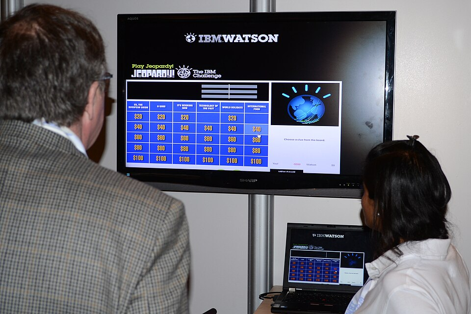</a> Raysonho @ Open Grid Scheduler / Grid Engine · <a href="https://creativecommons.org/licenses/by/3.0">CC BY 3.0</a> · <a href="https://commons.wikimedia.org/wiki/File:IBMWatson.jpg">Wikimedia Commons</a></td>
<td valign="top">

#### 💬 IBM Watson beats Jeopardy! champions Ken Jennings and Brad Rutter
**February 16, 2011** · 💬 Question answering (Jeopardy!) · *Watson / DeepQA (IBM Research, team led by David Ferrucci)* vs. *Ken Jennings and Brad Rutter, Jeopardy!'s two most successful champions*

IBM's question-answering system Watson played two games of Jeopardy!, broadcast over three episodes from 14 to 16 February 2011 and taped that January, against the show's two most successful champions, Ken Jennings and Brad Rutter. Watson won with $77,147 to Jennings's $24,000 and Rutter's $21,600, and IBM gave the $1 million first prize to charity. It ran IBM's DeepQA software on about 90 servers (2,880 processor cores) and had no internet connection during play.

**Why it matters:** The first time a computer beat the best human players at open-domain, natural-language trivia on live national television.

**Sources:** [Watson, 'Jeopardy!' champion](https://www.ibm.com/history/watson-jeopardy) (IBM) · [The Final Night Of IBM's Jeopardy Challenge: How Did Watson Do?](https://techcrunch.com/2011/02/16/the-final-night-of-ibms-jeopardy-challenge-how-did-watson-do) (TechCrunch) · [IBM Watson](https://en.wikipedia.org/wiki/IBM_Watson) (Wikipedia)

</td></tr></table>

<table><tr>
<td width="300" valign="top" align="center"><i>No freely licensed image yet</i></td>
<td valign="top">

#### 👁️ AlexNet wins ImageNet challenge by a huge margin, igniting deep learning
**October 13, 2012** · 👁️ Image classification · *AlexNet / SuperVision (Krizhevsky, Sutskever, Hinton; University of Toronto)*

Alex Krizhevsky, Ilya Sutskever and Geoffrey Hinton of the University of Toronto entered a deep convolutional neural network, trained on two NVIDIA GTX 580 GPUs, in the 2012 ImageNet Large Scale Visual Recognition Challenge as team "SuperVision". On the 1,000-category classification task its top-5 error was 15.3%, against 26.2% for the next-best team (ISI). The result was presented at the ECCV 2012 workshop in Florence, and the method was published at NIPS 2012.

**Why it matters:** The roughly 11-point winning margin persuaded the computer-vision field to adopt deep neural networks trained on GPUs, setting off the modern deep-learning boom.

**Sources:** [ImageNet Large Scale Visual Recognition Competition 2012 (ILSVRC2012) - Results](https://www.image-net.org/challenges/LSVRC/2012/results) (ImageNet / Stanford Vision Lab) · [ImageNet Classification with Deep Convolutional Neural Networks (NIPS 2012)](https://papers.nips.cc/paper/2012/hash/c399862d3b9d6b76c8436e924a68c45b-Abstract.html) (Advances in Neural Information Processing Systems 25) · [AlexNet](https://en.wikipedia.org/wiki/AlexNet) (Wikipedia)

</td></tr></table>

<table><tr>
<td width="300" valign="top"><a href="https://commons.wikimedia.org/wiki/File:Texas_Hold%27em_Poker_Table_with_Blinds.svg">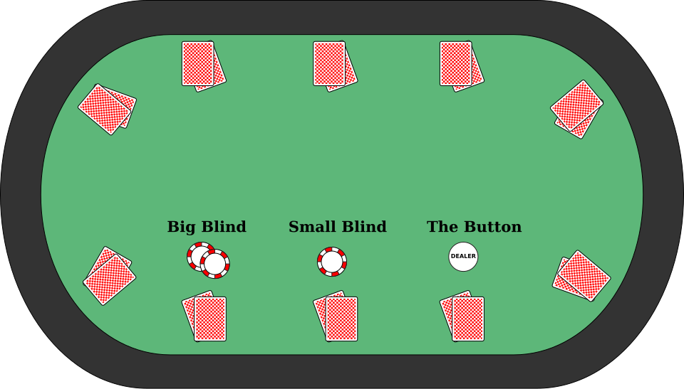</a> Original: Drm0hr Remake: Hazmat2 · <a href="https://creativecommons.org/licenses/by-sa/3.0">CC BY-SA 3.0</a> · <a href="https://commons.wikimedia.org/wiki/File:Texas_Hold%27em_Poker_Table_with_Blinds.svg">Wikimedia Commons</a></td>
<td valign="top">

#### ♟️ Cepheus essentially solves heads-up limit Texas hold'em poker
**January 8, 2015** · ♟️ Poker (heads-up limit hold'em) · *Cepheus (Computer Poker Research Group, University of Alberta)*

Michael Bowling, Neil Burch, Michael Johanson and Oskari Tammelin of the University of Alberta's Computer Poker Research Group reported in Science that their program Cepheus plays heads-up limit Texas hold'em so close to optimally that the game is "essentially weakly solved". The strategy comes from a new algorithm, CFR+, and the best possible counter-strategy would win only about 0.001 big blinds per game against it. The computation used roughly 4,000 CPUs for about two months.

**Why it matters:** The first time a poker game that people play competitively, a game with hidden information and bluffing, was essentially solved by a computer.

**Sources:** [Heads-up limit hold'em poker is solved](https://doi.org/10.1126/science.1259433) (Science (Bowling et al.)) · [How a computer program took the gambling out of poker](https://csmonitor.com/Science/2015/0108/How-a-computer-program-took-the-gambling-out-of-poker) (The Christian Science Monitor) · [Cepheus (poker bot)](https://en.wikipedia.org/wiki/Cepheus_(poker_bot)) (Wikipedia)

</td></tr></table>

<table><tr>
<td width="300" valign="top" align="center"><i>No freely licensed image yet</i></td>
<td valign="top">

#### 👁️ Microsoft network edges past reported human error rate on ImageNet
**February 6, 2015** · 👁️ Image classification · *PReLU-net (Microsoft Research)*

Kaiming He, Xiangyu Zhang, Shaoqing Ren and Jian Sun of Microsoft Research reported a top-5 error of 4.94% on the ImageNet 2012 classification benchmark. They used deep networks with a new learnable activation function (PReLU) and a better weight-initialization scheme. That beat the 5.1% previously measured for a trained human annotator and the 6.66% of GoogLeNet, the 2014 challenge winner.

**Why it matters:** The first published claim that a machine beat measured human accuracy at large-scale, 1,000-category image recognition.

**Sources:** [Delving Deep into Rectifiers: Surpassing Human-Level Performance on ImageNet Classification](https://www.arxiv.org/abs/1502.01852) (arXiv (He, Zhang, Ren, Sun)) · [Delving Deep into Rectifiers: Surpassing Human-Level Performance on ImageNet Classification](https://www.microsoft.com/en-us/research/publication/delving-deep-into-rectifiers-surpassing-human-level-performance-on-imagenet-classification/) (Microsoft Research) · [ImageNet](https://en.wikipedia.org/wiki/ImageNet) (Wikipedia)

</td></tr></table>

<table><tr>
<td width="300" valign="top"><a href="https://commons.wikimedia.org/wiki/File:Atari-2600-Wood-4Sw-Set.jpg">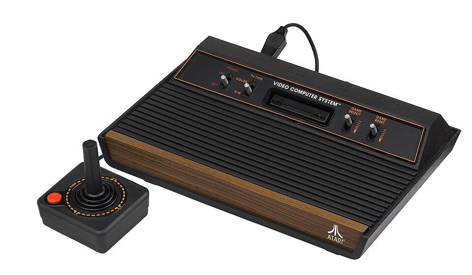</a> Evan-Amos · Public domain · <a href="https://commons.wikimedia.org/wiki/File:Atari-2600-Wood-4Sw-Set.jpg">Wikimedia Commons</a></td>
<td valign="top">

#### ♟️ DeepMind's DQN learns to play dozens of Atari games at human level
**February 25, 2015** · ♟️ Atari 2600 video games · *Deep Q-Network, DQN (Google DeepMind; Mnih, Kavukcuoglu, Silver, Hassabis et al.)*

DeepMind's deep Q-network (DQN) learned to play 49 classic Atari 2600 games using only the screen pixels and the score as input, with the same network architecture and settings for every game. In the Nature paper it outperformed earlier learning methods on 43 games. On 29 of them it scored more than 75% of what a professional human games tester achieved.

**Why it matters:** Showed that a single deep reinforcement-learning agent could learn many different tasks from raw pixels to roughly human level, launching the deep-RL era that led to AlphaGo.

**Sources:** [Human-level control through deep reinforcement learning (Nature 518, 529-533)](https://doi.org/10.1038/nature14236) (Nature) · [From Pixels to Actions: Human-level control through Deep Reinforcement Learning](https://research.google/blog/from-pixels-to-actions-human-level-control-through-deep-reinforcement-learning/) (Google Research Blog) · [Google AI Learns Classic Arcade Games From Scratch, Would Probably Beat You at Them](https://spectrum.ieee.org/google-ai-learns-classic-arcade-games-from-scratch-would-probably-beat-you-at-them) (IEEE Spectrum)

</td></tr></table>

<table><tr>
<td width="300" valign="top"><a href="https://commons.wikimedia.org/wiki/File:Lee_Se-Dol_-_2016_(cropped).jpg">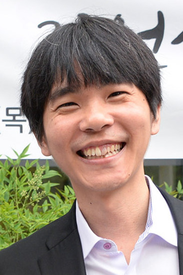</a> LG Electronics · <a href="https://creativecommons.org/licenses/by/2.0">CC BY 2.0</a> · <a href="https://commons.wikimedia.org/wiki/File:Lee_Se-Dol_-_2016_(cropped).jpg">Wikimedia Commons</a></td>
<td valign="top">

#### ♟️ AlphaGo defeats Go legend Lee Sedol 4-1 in Seoul
**March 15, 2016** · ♟️ Go · *AlphaGo (Google DeepMind)* vs. *Lee Sedol, 9-dan professional and 18-time world title winner*

In the five-game DeepMind Challenge Match at the Four Seasons Hotel in Seoul, held from 9 to 15 March 2016, AlphaGo beat Lee Sedol 4-1. Lee was a 9-dan professional with 18 world titles. AlphaGo's unconventional move 37 in game 2 became famous, and Lee's only win came in game 4 with his own celebrated move 78. AlphaGo combined deep policy and value networks with Monte Carlo tree search. The approach was described in Nature in January 2016, when DeepMind also revealed that AlphaGo had beaten European champion Fan Hui 5-0 in October 2015.

**Why it matters:** Go, with its vast number of possible positions, had long been the grand challenge of board-game AI, and this was the first time a program beat a world-class professional in a full match.

**Sources:** [What we learned in Seoul with AlphaGo](https://blog.google/technology/ai/what-we-learned-in-seoul-with-alphago/) (Google (Demis Hassabis, DeepMind)) · [Mastering the game of Go with deep neural networks and tree search (Nature 529, 484-489)](https://doi.org/10.1038/nature16961) (Nature) · [AlphaGo versus Lee Sedol](https://en.wikipedia.org/wiki/AlphaGo_versus_Lee_Sedol) (Wikipedia)

</td></tr></table>

<table><tr>
<td width="300" valign="top" align="center"><i>No freely licensed image yet</i></td>
<td valign="top">

#### 🧮 SAT solver settles the Boolean Pythagorean triples problem with a 200 TB proof
**May 3, 2016** · 🧮 Ramsey theory / automated reasoning · *Cube-and-conquer SAT solving (Heule, Kullmann, Marek; UT Austin and Swansea)*

Marijn Heule, Oliver Kullmann and Victor Marek used a SAT solver to answer a decades-old question of Ronald Graham's. The integers 1 to 7,824 can be split into two colors without any single-colored Pythagorean triple (a² + b² = c²), but 1 to 7,825 cannot. Their "cube-and-conquer" method ran for about two days on an 800-core cluster (the Stampede supercomputer). It produced a machine-checkable proof of almost 200 terabytes, which they compressed into a 68 GB certificate.

**Why it matters:** At the time it was the largest mathematical proof ever produced, and it showed automated reasoning settling an open problem that human mathematicians had not cracked.

**Sources:** [Solving and Verifying the boolean Pythagorean Triples problem via Cube-and-Conquer](https://arxiv.org/abs/1605.00723) (arXiv (SAT 2016)) · [Boolean Pythagorean triples problem](https://en.wikipedia.org/wiki/Boolean_Pythagorean_triples_problem) (Wikipedia) · [Two-hundred-terabyte maths proof is largest ever](https://doi.org/10.1038/nature.2016.19990) (Nature News)

</td></tr></table>

<table><tr>
<td width="300" valign="top" align="center"><i>No freely licensed image yet</i></td>
<td valign="top">

#### 👁️ Microsoft claims human parity in conversational speech recognition
**October 18, 2016** · 👁️ Speech recognition · *Microsoft conversational speech recognition system (Microsoft AI and Research)*

A Microsoft Artificial Intelligence and Research team (Wayne Xiong, Jasha Droppo, Xuedong Huang, Frank Seide, Mike Seltzer, Andreas Stolcke, Dong Yu, Geoffrey Zweig) reported a 5.9% word error rate on the Switchboard portion of the NIST 2000 telephone-conversation benchmark. That matched the 5.9% they measured for professional transcribers. The system combined several convolutional and LSTM acoustic models with recurrent neural-network language models. The current arXiv abstract gives 5.8% on Switchboard and 11.0% on CallHome, against 5.9% and 11.3% for humans.

**Why it matters:** The first claim that a machine matched professional human transcribers on a standard benchmark of spontaneous conversational speech.

**Sources:** [Historic milestone: Microsoft researchers achieve human parity in conversational speech recognition](https://blogs.microsoft.com/blog/2016/10/18/historic-milestone-microsoft-researchers-achieve-human-parity-conversational-speech-recognition/) (Microsoft) · [Achieving Human Parity in Conversational Speech Recognition](https://arxiv.org/abs/1610.05256) (arXiv (Xiong et al.)) · [Microsoft claims its new speech recognition system on par with human capabilities](https://techxplore.com/news/2016-10-microsoft-speech-recognition-par-human.amp) (Tech Xplore)

</td></tr></table>

<table><tr>
<td width="300" valign="top" align="center"><i>No freely licensed image yet</i></td>
<td valign="top">

#### ♟️ Libratus beats top professionals at heads-up no-limit Texas hold'em
**January 30, 2017** · ♟️ Poker (heads-up no-limit hold'em) · *Libratus (Carnegie Mellon University; Tuomas Sandholm and Noam Brown)* vs. *Jason Les, Dong Kim, Daniel McAulay and Jimmy Chou, top heads-up no-limit professionals*

In the 20-day "Brains Vs. Artificial Intelligence: Upping the Ante" event at Rivers Casino in Pittsburgh, Carnegie Mellon's Libratus played 120,000 hands of heads-up no-limit Texas hold'em against four specialist pros: Jason Les, Dong Kim, Daniel McAulay and Jimmy Chou. Libratus was built by Tuomas Sandholm and Ph.D. student Noam Brown and ran on the Pittsburgh Supercomputing Center's Bridges machine. It finished $1,766,250 ahead in chips, about 14.7 big blinds per 100 hands, a margin its makers called statistically significant. Separately, DeepStack (University of Alberta with Charles University and Czech Technical University) beat professionals over 44,000 hands in late 2016, reported in Science in March 2017.

**Why it matters:** The first time an AI decisively beat top human professionals at no-limit hold'em, a hidden-information game of bluffing long considered out of reach.

**Sources:** [Carnegie Mellon Artificial Intelligence Beats Top Poker Pros](https://www.cmu.edu/news/stories/archives/2017/january/AI-beats-poker-pros.html) (Carnegie Mellon University) · [Superhuman AI for heads-up no-limit poker: Libratus beats top professionals (Science 359(6374))](https://par.nsf.gov/biblio/10077416) (Science (via NSF Public Access Repository)) · [How an AI took down four world-class poker pros](https://www.engadget.com/2017-02-10-libratus-ai-poker-winner.html) (Engadget) · [DeepStack: Expert-Level Artificial Intelligence in Heads-Up No-Limit Poker](https://arxiv.org/abs/1701.01724v3) (arXiv (Moravčík et al.; Science 2017)) · [Libratus](https://en.wikipedia.org/wiki/Libratus) (Wikipedia)

</td></tr></table>

<table><tr>
<td width="300" valign="top" align="center"><i>No freely licensed image yet</i></td>
<td valign="top">

#### ♟️ Shogi program Ponanza defeats reigning Meijin Amahiko Sato
**May 20, 2017** · ♟️ Shogi · *Ponanza (Issei Yamamoto and Hiroshi Shimozumi)* vs. *Amahiko Sato, reigning Meijin*

In the second and final Denou-sen, a human-versus-computer series run by DWANGO's niconico, the program Ponanza played the reigning Meijin, Amahiko Sato, in a two-game match: game 1 on 1 April 2017 at Nikko Toshogu and game 2 on 20 May 2017 at Himeji Castle. Ponanza won both games, and the organizers ended the series with that match.

**Why it matters:** A program beat the reigning Meijin, holder of shogi's most prestigious title, ending high-profile human-versus-computer title matches in Japan's national board game.

**Sources:** [第2期 電王戦 第1局 (2nd Denou-sen, Game 1)](https://denou.jp/2017/kifu/20170401.html) (niconico / DWANGO (official)) · [第2期 電王戦 第2局 (2nd Denou-sen, Game 2)](https://denou.jp/2017/kifu/20170520.html) (niconico / DWANGO (official)) · [Computer shogi](https://en.wikipedia.org/wiki/Computer_shogi) (Wikipedia) · [Amahiko Satō](https://en.wikipedia.org/wiki/Amahiko_Sat%C5%8D) (Wikipedia) · [Satō Meijin loses twice in a row to Ponanza (in Japanese)](https://www.sankei.com/west/news/170520/wst1705200079-n1.html) (Sankei Shimbun)

</td></tr></table>

<table><tr>
<td width="300" valign="top"><a href="https://commons.wikimedia.org/wiki/File:Ke_Jie_(%E6%9F%AF%E6%B4%81)_2019_portrait.jpg">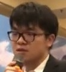</a> 中国新闻网 · <a href="https://creativecommons.org/licenses/by/3.0">CC BY 3.0</a> · <a href="https://commons.wikimedia.org/wiki/File:Ke_Jie_(%E6%9F%AF%E6%B4%81)_2019_portrait.jpg">Wikimedia Commons</a></td>
<td valign="top">

#### ♟️ AlphaGo Master sweeps world No. 1 Ke Jie 3-0
**May 27, 2017** · ♟️ Go · *AlphaGo Master (Google DeepMind)* vs. *Ke Jie, world No. 1 ranked Go player*

At the Future of Go Summit in Wuzhen, China, an upgraded AlphaGo ("Master") beat Ke Jie, then ranked number one in the world, in all three games on 23, 25 and 27 May 2017. The first game was won by just half a point. The same version had already gone 60-0 against top professionals in fast online games under the accounts "Magister" and "Master" around New Year 2017. After the summit DeepMind retired AlphaGo from competitive play, and the Chinese Weiqi Association awarded it an honorary professional 9-dan rank.

**Why it matters:** Beating the world's top-ranked player removed any remaining doubt that machines had overtaken humans at Go.

**Sources:** [AlphaGo's next move](https://blog.google/around-the-globe/google-asia/alphagos-next-move) (Google / DeepMind (Demis Hassabis and David Silver)) · [Glorious still is Ke Jie despite 0-3 loss to AlphaGo](https://news.cgtn.com/news/3d49544f7a41444e/share_p.html) (CGTN) · [AlphaGo versus Ke Jie](https://en.wikipedia.org/wiki/AlphaGo_versus_Ke_Jie) (Wikipedia)

</td></tr></table>

<table><tr>
<td width="300" valign="top"><a href="https://commons.wikimedia.org/wiki/File:Transformer,_full_architecture.png">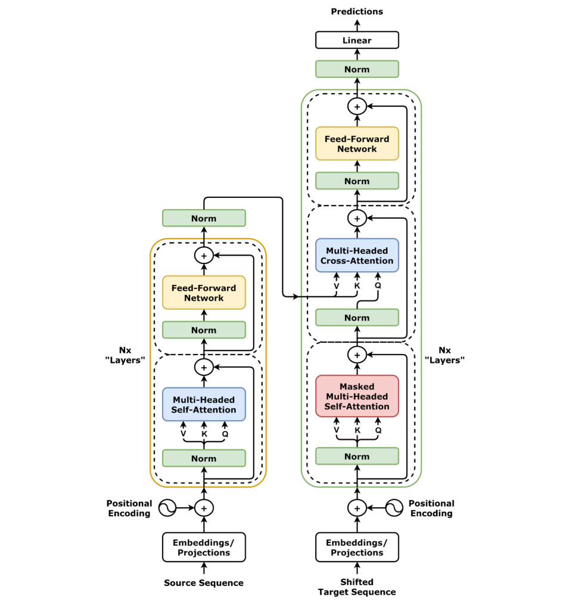</a> dvgodoy · <a href="https://creativecommons.org/licenses/by/4.0">CC BY 4.0</a> · <a href="https://commons.wikimedia.org/wiki/File:Transformer,_full_architecture.png">Wikimedia Commons</a></td>
<td valign="top">

#### 🧱 "Attention Is All You Need" introduces the Transformer
**June 12, 2017** · 🧱 Neural network architecture / NLP · *Transformer (Vaswani et al., Google)*

Eight Google researchers proposed the Transformer, a sequence-to-sequence model built entirely from attention mechanisms, with no recurrence or convolution. The authors were Ashish Vaswani, Noam Shazeer, Niki Parmar, Jakob Uszkoreit, Llion Jones, Aidan Gomez, Łukasz Kaiser and Illia Polosukhin. The model set machine-translation records on WMT 2014 (28.4 BLEU English-German, 41.8 BLEU English-French) and trained much faster than earlier models; the English-French model took 3.5 days on eight GPUs. The paper was posted to arXiv on 12 June 2017 and presented at NIPS 2017.

**Why it matters:** The Transformer became the architecture behind BERT, GPT and nearly every later large language model, making this the foundational paper of the LLM era.

**Sources:** [Attention Is All You Need](https://arxiv.org/abs/1706.03762) (arXiv (Vaswani et al.; NIPS 2017)) · [Attention Is All You Need](https://en.wikipedia.org/wiki/Attention_Is_All_You_Need) (Wikipedia)

</td></tr></table>

<table><tr>
<td width="300" valign="top"><a href="https://commons.wikimedia.org/wiki/File:FloorGoban.JPG">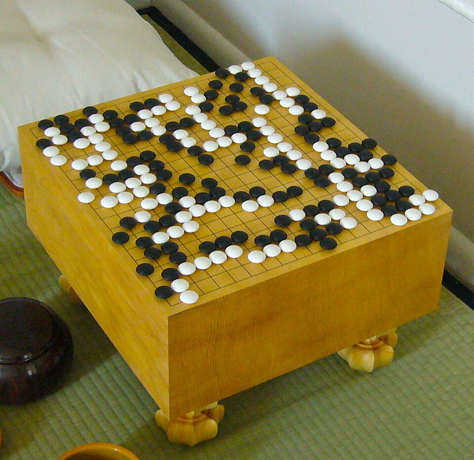</a> Goban1 · Public domain · <a href="https://commons.wikimedia.org/wiki/File:FloorGoban.JPG">Wikimedia Commons</a></td>
<td valign="top">

#### ♟️ AlphaGo Zero masters Go from scratch with no human data
**October 18, 2017** · ♟️ Go · *AlphaGo Zero (Google DeepMind)*

DeepMind's AlphaGo Zero learned Go entirely by playing against itself. It started from random moves, knew only the rules and saw no human game records. After three days of self-play it beat the version that defeated Lee Sedol by 100 games to 0, and after 40 days it surpassed AlphaGo Master, the version that beat Ke Jie. It used one combined neural network, no rollouts and just 4 TPUs.

**Why it matters:** Showed that superhuman skill in a famously hard domain could be reached with no human knowledge beyond the rules.

**Sources:** [AlphaGo Zero: Starting from scratch](https://deepmind.google/blog/alphago-zero-starting-from-scratch/) (Google DeepMind) · [Mastering the game of Go without human knowledge (Nature 550, 354-359)](https://discovery.ucl.ac.uk/id/eprint/10045895/) (Nature (record via UCL Discovery)) · [AlphaGo](https://en.wikipedia.org/wiki/AlphaGo) (Wikipedia)

</td></tr></table>

<table><tr>
<td width="300" valign="top" align="center"><i>No freely licensed image yet</i></td>
<td valign="top">

#### ♟️ AlphaZero teaches itself chess, shogi and Go and beats the top programs
**December 5, 2017** · ♟️ Chess, shogi and Go · *AlphaZero (Google DeepMind)*

DeepMind's AlphaZero generalized the AlphaGo Zero method: one algorithm, given only the rules, learned chess, shogi and Go through self-play. The December 2017 preprint reports it surpassed Stockfish in chess after about four hours of training and beat Stockfish 8 by 28 wins, 72 draws and no losses over 100 games. It also beat the shogi champion program Elmo (90 wins, 8 losses, 2 draws) and a 3-day AlphaGo Zero (60-40). A peer-reviewed version in Science (7 December 2018) reported a 1,000-game chess match against Stockfish at long time controls that ended with 155 wins, 6 losses and 839 draws.

**Why it matters:** A single general-purpose self-learning algorithm became the strongest player of three different classic games, beating decades of hand-tuned engines.

**Sources:** [Mastering Chess and Shogi by Self-Play with a General Reinforcement Learning Algorithm](https://arxiv.org/abs/1712.01815v1) (arXiv (Silver et al.)) · [A general reinforcement learning algorithm that masters chess, shogi, and Go through self-play (Science 362(6419):1140-1144)](https://discovery.ucl.ac.uk/id/eprint/10069050/) (Science (record via UCL Discovery)) · [AlphaZero](https://en.wikipedia.org/wiki/AlphaZero) (Wikipedia)

</td></tr></table>

<table><tr>
<td width="300" valign="top" align="center"><i>No freely licensed image yet</i></td>
<td valign="top">

#### 💬 Google's BERT makes pretrain-then-fine-tune the standard recipe for NLP
**October 11, 2018** · 💬 Natural language understanding · *BERT (Google AI Language)*

Google AI researchers (Devlin, Chang, Lee and Toutanova) released BERT, a Transformer pretrained on unlabeled text by predicting masked-out words using context on both sides, then fine-tuned for individual tasks. It set new records on 11 benchmarks, including a GLUE score of 80.5 (+7.7 points) and 93.2 F1 on the SQuAD v1.1 reading-comprehension test. Google began using BERT in Search for US English queries in October 2019.

**Why it matters:** BERT showed that a single large pretrained language model could be adapted to almost any language task, which set off the pretrained-model era that led to GPT-3 and ChatGPT.

**Sources:** [BERT: Pre-training of Deep Bidirectional Transformers for Language Understanding](https://arxiv.org/abs/1810.04805) (arXiv (Devlin et al.)) · [BERT (language model)](https://en.wikipedia.org/wiki/BERT_(language_model)) (Wikipedia)

</td></tr></table>

<table><tr>
<td width="300" valign="top" align="center"><i>No freely licensed image yet</i></td>
<td valign="top">

#### ♟️ DeepMind's AlphaStar beats StarCraft II pros TLO and MaNa 10-1
**January 24, 2019** · ♟️ StarCraft II · *AlphaStar (DeepMind)* vs. *Dario "TLO" Wünsch and Grzegorz "MaNa" Komincz, Team Liquid professionals*

DeepMind revealed that in recorded matches in December 2018, a preliminary version of AlphaStar won 5-0 against Dario "TLO" Wünsch and 5-0 against Grzegorz "MaNa" Komincz, both of Team Liquid, in Protoss-vs-Protoss games on a single map. In a live exhibition on 24 January 2019, MaNa beat a new AlphaStar version that was restricted to a human-like camera view, giving AlphaStar its first loss to a pro.

**Why it matters:** This was the first time an AI defeated top professional players at StarCraft II, a real-time strategy game with hidden information and a huge action space.

**Sources:** [DeepMind AI AlphaStar goes 10-1 against top 'StarCraft II' pros](https://www.engadget.com/2019/01/24/deepmind-ai-starcraft-ii-demonstration-tlo-mana/) (Engadget) · [DeepMind's new AI just beat top human pro gamers at StarCraft II for the first time](https://www.technologyreview.com/2019/01/25/137714/deepminds-new-ai-just-beat-top-human-pro-gamers-at-starcraft-ii-for-the-first/) (MIT Technology Review) · [AlphaStar (software)](https://en.wikipedia.org/wiki/AlphaStar_(software)) (Wikipedia)

</td></tr></table>

<table><tr>
<td width="300" valign="top"><a href="https://commons.wikimedia.org/wiki/File:The_International_Dota_2_video_game_tournament.jpg">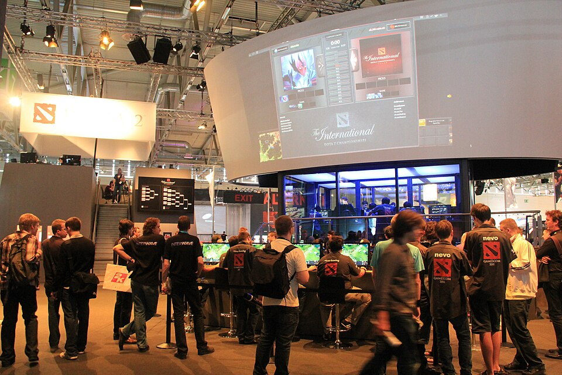</a> YJ · <a href="https://creativecommons.org/licenses/by-sa/2.0">CC BY-SA 2.0</a> · <a href="https://commons.wikimedia.org/wiki/File:The_International_Dota_2_video_game_tournament.jpg">Wikimedia Commons</a></td>
<td valign="top">

#### ♟️ OpenAI Five defeats Dota 2 world champions OG
**April 13, 2019** · ♟️ Dota 2 · *OpenAI Five (OpenAI)* vs. *OG, reigning The International 2018 Dota 2 world champions*

At a live event in San Francisco, OpenAI's five-agent team beat OG, the reigning champions of The International 2018, 2-0 in a best-of-three series of 5v5 Dota 2. The bots trained by self-play reinforcement learning for about 10 months. In a public online "Arena" held days later, they won 99.4% of 42,729 games against all comers.

**Why it matters:** This was the first time an AI beat the reigning world champions of a major esport, in a long-horizon team game played with hidden information.

**Sources:** [OpenAI Five defeats Dota 2 world champions](https://openai.com/index/openai-five-defeats-dota-2-world-champions) (OpenAI) · [Dota 2 with Large Scale Deep Reinforcement Learning](https://arxiv.org/abs/1912.06680) (arXiv (OpenAI et al.)) · [OpenAI Five](https://en.wikipedia.org/wiki/OpenAI_Five) (Wikipedia) · [AI defeated a top-tier 'Dota 2' esports team](https://www.engadget.com/2019/04/14/openai-ai-defeats-dota-2-esports-team/) (Engadget)

</td></tr></table>

<table><tr>
<td width="300" valign="top"><a href="https://commons.wikimedia.org/wiki/File:Poker-Texas-Holdem-multiplayer.jpg">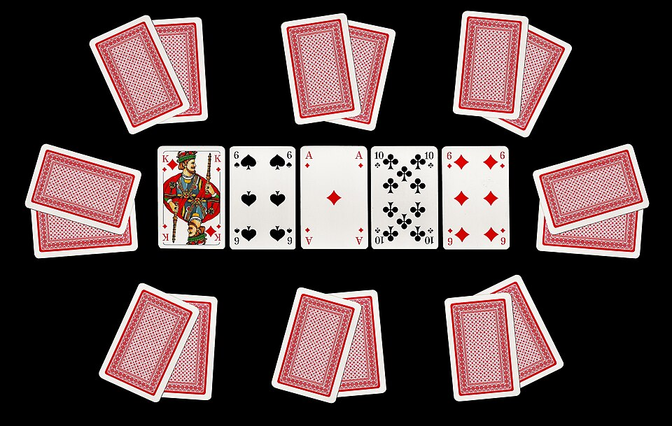</a> Nyks at German Wikipedia · <a href="http://creativecommons.org/licenses/by-sa/3.0/">CC BY-SA 3.0</a> · <a href="https://commons.wikimedia.org/wiki/File:Poker-Texas-Holdem-multiplayer.jpg">Wikimedia Commons</a></td>
<td valign="top">

#### ♟️ Pluribus beats elite pros at six-player no-limit Texas hold'em
**July 11, 2019** · ♟️ Poker · *Pluribus (Carnegie Mellon University and Facebook AI)* vs. *Elite professional poker players, including Chris Ferguson and Darren Elias*

Noam Brown and Tuomas Sandholm of Carnegie Mellon and Facebook AI built Pluribus, which played 10,000 hands of six-player no-limit hold'em against elite professionals over 12 days. It won an average of 48 milli-big-blinds per game in the one-AI, five-human format, and also beat Chris Ferguson and Darren Elias, each playing alongside five copies of the bot. Its blueprint strategy cost about 12,400 CPU core-hours to compute, on a single 64-core server.

**Why it matters:** This was the first time an AI beat top humans at a multiplayer poker game (more than two players), where game-theoretic guarantees from two-player games no longer apply.

**Sources:** [Superhuman AI for multiplayer poker (Science, doi:10.1126/science.aay2400; accepted manuscript)](https://par.nsf.gov/servlets/purl/10119653) (Science / NSF Public Access Repository) · [Pluribus (poker bot)](https://en.wikipedia.org/wiki/Pluribus_(poker_bot)) (Wikipedia) · [AI program beats pros in six-player poker -- a first](https://technology.inquirer.net/88895/ai-program-beats-pros-in-six-player-poker-a-first) (Inquirer Technology (AFP))

</td></tr></table>

<table><tr>
<td width="300" valign="top" align="center"><i>No freely licensed image yet</i></td>
<td valign="top">

#### ♟️ AlphaStar reaches Grandmaster level in StarCraft II on Battle.net
**October 30, 2019** · ♟️ StarCraft II · *AlphaStar Final (DeepMind)* vs. *Ranked human players on the European Battle.net ladder*

DeepMind reported in Nature that AlphaStar reached Grandmaster rank with all three races (Protoss, Terran and Zerg) while playing anonymously on Blizzard's public Battle.net ladder, ranking above 99.8% of active players. Unlike the January demo, this version saw the game through a camera view like a human's and was capped at 22 actions per 5 seconds, limits approved by a professional player.

**Why it matters:** An AI reached the top human league of a major esport under human-like constraints, playing the full game against the general competitive population rather than in staged matches.

**Sources:** [AlphaStar: Grandmaster level in StarCraft II using multi-agent reinforcement learning](https://deepmind.google/discover/blog/alphastar-grandmaster-level-in-starcraft-ii-using-multi-agent-reinforcement-learning/) (Google DeepMind) · [Grandmaster level in StarCraft II using multi-agent reinforcement learning (Vinyals et al., Nature 575, 350-354)](https://doi.org/10.1038/s41586-019-1724-z) (Nature) · [AlphaStar (software)](https://en.wikipedia.org/wiki/AlphaStar_(software)) (Wikipedia)

</td></tr></table>

<a href="#contents">↑ back to contents</a>

### 2020s

<table><tr>
<td width="300" valign="top" align="center"><i>No freely licensed image yet</i></td>
<td valign="top">

#### ♟️ Agent57 beats the human benchmark on all 57 Atari games
**March 31, 2020** · ♟️ Atari 2600 · *Agent57 (DeepMind)*

DeepMind's Agent57 became the first deep reinforcement learning agent to score above the standard human baseline on every game in the 57-game Atari benchmark. That included Montezuma's Revenge, Pitfall, Solaris and Skiing, which had defeated earlier agents. It combines a curiosity-driven exploration method with a meta-controller that decides how much to explore versus exploit.

**Why it matters:** This closed out the Atari benchmark that DQN made famous in 2013-2015, with superhuman scores on the whole suite, including the hardest exploration games.

**Sources:** [Agent57: Outperforming the human Atari benchmark](https://deepmind.google/blog/agent57-outperforming-the-human-atari-benchmark/) (Google DeepMind) · [Agent57: Outperforming the Atari Human Benchmark (Badia et al.)](https://arxiv.org/abs/2003.13350) (arXiv)

</td></tr></table>

<table><tr>
<td width="300" valign="top"><a href="https://commons.wikimedia.org/wiki/File:Full_GPT_architecture.png">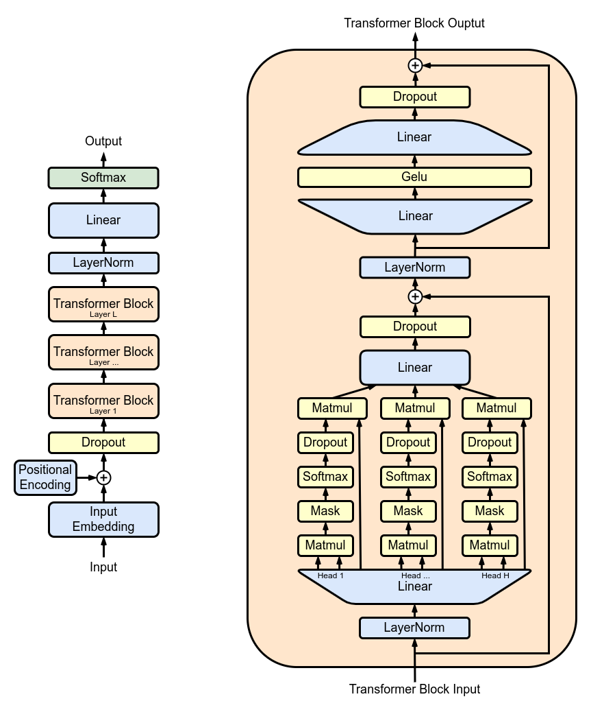</a> Marxav · <a href="http://creativecommons.org/publicdomain/zero/1.0/deed.en">CC0</a> · <a href="https://commons.wikimedia.org/wiki/File:Full_GPT_architecture.png">Wikimedia Commons</a></td>
<td valign="top">

#### 💬 GPT-3 shows that sheer scale unlocks few-shot learning
**May 28, 2020** · 💬 Large language models · *GPT-3 (OpenAI)*

OpenAI described GPT-3, a 175-billion-parameter language model about ten times larger than any previous dense model. It could translate, answer questions and do simple reasoning tasks from just a few examples in its prompt, without any fine-tuning. OpenAI offered it through an API from June 2020, and Microsoft licensed the underlying model exclusively that September.

**Why it matters:** GPT-3 showed that scaling language models produces broad new abilities, which made prompt-based "in-context learning" a new way of using AI.

**Sources:** [Language Models are Few-Shot Learners (Brown et al.)](https://arxiv.org/abs/2005.14165v2) (arXiv) · [GPT-3](https://en.wikipedia.org/wiki/GPT-3) (Wikipedia)

</td></tr></table>

<table><tr>
<td width="300" valign="top"> SMSGT JOHN P. ROHRER, USAF · Public domain · <a href="https://commons.wikimedia.org/wiki/File:F-16C_Fighting_Falcon.JPEG">Wikimedia Commons</a></td>
<td valign="top">

#### 🤖 AI pilot beats a human F-16 pilot 5-0 in DARPA's AlphaDogfight Trials
**August 20, 2020** · 🤖 Air combat (simulation) · *Heron Systems AI agent (DARPA Air Combat Evolution program)* vs. *Experienced USAF F-16 pilot "Banger", trained at the USAF Weapons School*

In the final of DARPA's AlphaDogfight Trials, an AI agent from Heron Systems, a small Maryland company, swept an experienced US Air Force F-16 pilot (callsign "Banger") 5-0 in simulated within-visual-range dogfights, with both sides flying virtual F-16s. Heron had first beaten seven other teams' agents, including Lockheed Martin's in the final bracket, to win the right to face the human.

**Why it matters:** It was a high-profile demonstration that a reinforcement-learning agent could outfly a trained fighter pilot in a close-range dogfight, at least in simulation.

**Sources:** [DARPA news release on the AlphaDogfight Trials](https://www.darpa.mil/news/2020/alphadogfight-trial) (DARPA) · [AI Slays Top F-16 Pilot In DARPA Dogfight Simulation](https://breakingdefense.com/2020/08/ai-slays-top-f-16-pilot-in-darpa-dogfight-simulation) (Breaking Defense)

</td></tr></table>

<table><tr>
<td width="300" valign="top"><a href="https://commons.wikimedia.org/wiki/File:Waymo_Chrysler_Pacifica_in_Los_Altos,_2017.jpg">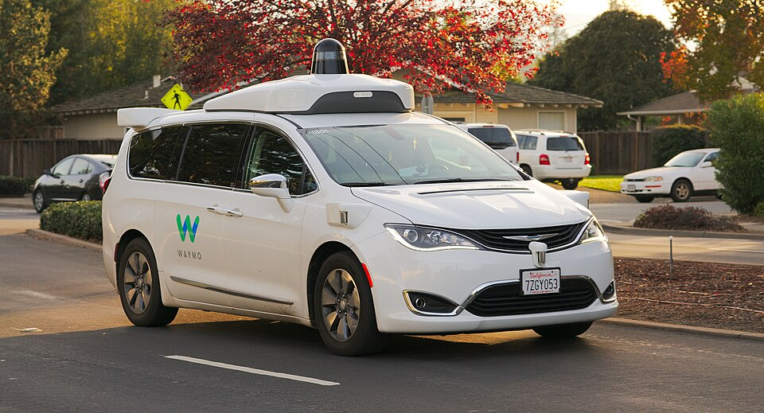</a> Dllu · <a href="https://creativecommons.org/licenses/by-sa/4.0">CC BY-SA 4.0</a> · <a href="https://commons.wikimedia.org/wiki/File:Waymo_Chrysler_Pacifica_in_Los_Altos,_2017.jpg">Wikimedia Commons</a></td>
<td valign="top">

#### 🤖 Waymo opens fully driverless ride-hailing to the public in Phoenix
**October 8, 2020** · 🤖 Autonomous driving · *Waymo Driver (Waymo / Alphabet)*

Waymo began offering rides with no safety driver on board to its Waymo One customers in suburban Phoenix, and said it would soon open to new riders through its app. Before this, only a few hundred early riders under NDA had taken driverless trips, which were about 5-10% of rides. The service area covered roughly 50 square miles and used a fleet of Chrysler Pacifica minivans.

**Why it matters:** This was the first time a company opened a fully driverless robotaxi service to members of the public, taking self-driving cars from test programs to everyday commercial use.

**Sources:** [Waymo is opening its fully driverless service to the general public in Phoenix](https://waymo.com/blog/2020/10/waymo-is-opening-its-fully-driverless-service-in-phoenix/) (Waymo) · [Waymo begins fully driverless rides in Arizona](https://www.bnnbloomberg.ca/waymo-begins-fully-driverless-rides-in-arizona-1.1505565) (BNN Bloomberg (Bloomberg News))

</td></tr></table>

<table><tr>
<td width="300" valign="top"><a href="https://commons.wikimedia.org/wiki/File:AlphaFold_2.png">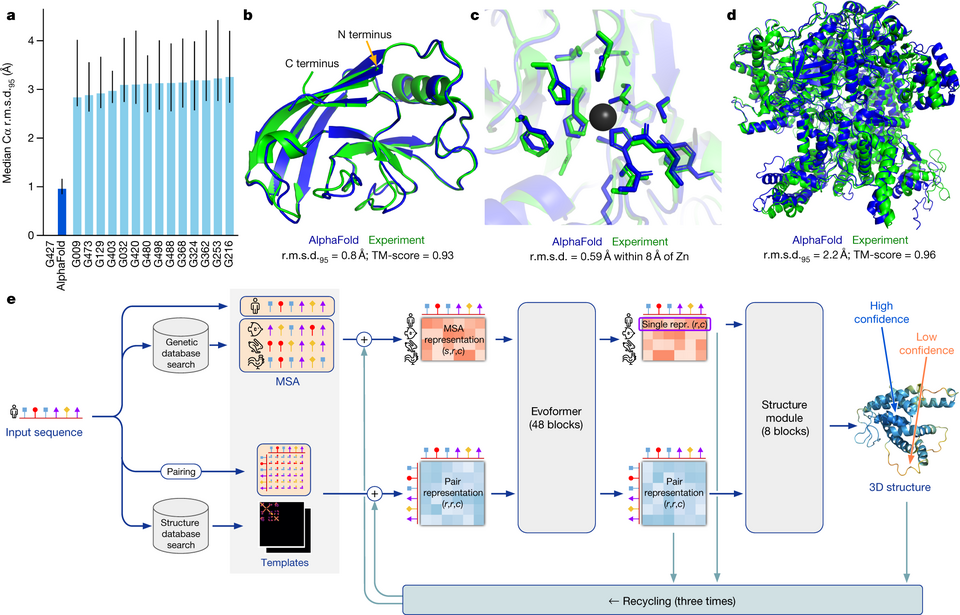</a> John Jumper et al · <a href="https://creativecommons.org/licenses/by/4.0">CC BY 4.0</a> · <a href="https://commons.wikimedia.org/wiki/File:AlphaFold_2.png">Wikimedia Commons</a></td>
<td valign="top">

#### 🔬 AlphaFold 2 solves protein structure prediction at CASP14
**November 30, 2020** · 🔬 Protein folding · *AlphaFold 2 (DeepMind)*

In the CASP14 blind assessment, DeepMind's AlphaFold 2 predicted protein 3D structures with a median GDT score of 92.4 across all targets, an average error of about 1.6 Å. That is near the level of experimental methods, and far ahead of every other entrant. CASP's organizers described it as a solution to the 50-year-old protein-folding problem. The method was published in Nature in July 2021 along with open-source code.

**Why it matters:** AI solved a grand challenge in biology at experimental-grade accuracy, which changed how structural biology and drug discovery work and contributed to the 2024 Nobel Prize in Chemistry.

**Sources:** [AlphaFold: a solution to a 50-year-old grand challenge in biology](https://deepmind.google/blog/alphafold-a-solution-to-a-50-year-old-grand-challenge-in-biology/) (Google DeepMind) · [Highly accurate protein structure prediction with AlphaFold (Jumper et al., Nature 596, 583-589)](https://doi.org/10.1038/s41586-021-03819-2) (Nature) · [AlphaFold](https://en.wikipedia.org/wiki/AlphaFold) (Wikipedia)

</td></tr></table>

<table><tr>
<td width="300" valign="top" align="center"><i>No freely licensed image yet</i></td>
<td valign="top">

#### ♟️ MuZero masters Go, chess, shogi and Atari without being told the rules
**December 23, 2020** · ♟️ Go, chess, shogi, Atari · *MuZero (DeepMind)*

DeepMind's MuZero learns its own internal model of a game, predicting only what matters for planning (value, best move and reward), and plans with tree search over that model. In Nature it matched AlphaZero in Go, chess and shogi without being given the rules, and set a new state of the art across 57 Atari games. A preprint had appeared in November 2019.

**Why it matters:** It extended AlphaZero-style superhuman planning to settings where the rules or environment dynamics are unknown, a step toward planning in messy real-world problems.

**Sources:** [MuZero: Mastering Go, chess, shogi and Atari without rules](https://deepmind.google/blog/muzero-mastering-go-chess-shogi-and-atari-without-rules/) (Google DeepMind) · [Mastering Atari, Go, chess and shogi by planning with a learned model (Schrittwieser et al., Nature 588, 604-609; doi:10.1038/s41586-020-03051-4)](https://ideas.repec.org/a/nat/nature/v588y2020i7839d10.1038_s41586-020-03051-4.html) (Nature (RePEc/IDEAS record)) · [MuZero](https://en.wikipedia.org/wiki/MuZero) (Wikipedia)

</td></tr></table>

<table><tr>
<td width="300" valign="top"> Jim.belk · Public domain · <a href="https://commons.wikimedia.org/wiki/File:Blue_Trefoil_Knot.png">Wikimedia Commons</a></td>
<td valign="top">

#### 🧮 AI guides mathematicians to new results in knot theory and representation theory
**December 1, 2021** · 🧮 Knot theory / representation theory · *DeepMind machine-learning framework, with University of Oxford and University of Sydney mathematicians*

DeepMind worked with mathematicians at Oxford (Marc Lackenby, András Juhász) and Sydney (Geordie Williamson), using machine learning to spot patterns and attribution methods to highlight which quantities mattered. In knot theory this led to a proven theorem linking a knot's algebraic signature to its geometry through a new quantity, the "natural slope". In representation theory it pointed toward a proposed proof route for the roughly 40-year-old combinatorial invariance conjecture for Kazhdan-Lusztig polynomials, which was checked on more than 3 million examples.

**Why it matters:** This was a widely recognized case of machine learning helping professional mathematicians make new conjectures and theorems in pure mathematics, published in Nature.

**Sources:** [Exploring the beauty of pure mathematics in novel ways](https://deepmind.google/discover/blog/exploring-the-beauty-of-pure-mathematics-in-novel-ways/) (Google DeepMind) · [Advancing mathematics by guiding human intuition with AI (Davies et al.)](https://www.nature.com/articles/s41586-021-04086-x) (Nature) · [Machine learning helps mathematicians make new connections](https://www.ox.ac.uk/news/2021-12-01-machine-learning-helps-mathematicians-make-new-connections-0) (University of Oxford)

</td></tr></table>

<table><tr>
<td width="300" valign="top" align="center"><i>No freely licensed image yet</i></td>
<td valign="top">

#### 🧮 AlphaCode performs at median-competitor level in coding contests
**February 2, 2022** · 🧮 Competitive programming · *AlphaCode (DeepMind)* vs. *Human participants in 10 Codeforces contests (simulated evaluation)*

DeepMind's AlphaCode, a Transformer system pretrained on GitHub code and fine-tuned on contest problems, generates huge numbers of candidate C++ and Python programs per problem. It then filters and clusters them down to 10 submissions. In simulated entries to 10 recent Codeforces contests, held after its training data was collected, it ranked on average in the top 54.3% of participants, about the level of the median human competitor. The work appeared in Science in December 2022.

**Why it matters:** This was the first time an AI code-generation system performed at a competitive level in programming contests that require reading a problem statement and inventing an algorithm.

**Sources:** [Competitive programming with AlphaCode](https://deepmind.google/discover/blog/competitive-programming-with-alphacode/) (Google DeepMind) · [Competition-Level Code Generation with AlphaCode (Li et al.)](https://arxiv.org/abs/2203.07814) (arXiv) · [DeepMind's AI programming tool AlphaCode tests in top 54% of human coders](https://techxplore.com/news/2022-02-deepmind-ai-tool-alphacode-human.amp) (TechXplore)

</td></tr></table>

<table><tr>
<td width="300" valign="top" align="center"><i>No freely licensed image yet</i></td>
<td valign="top">

#### ♟️ Sony's Gran Turismo Sophy outraces the world's best Gran Turismo drivers
**February 9, 2022** · ♟️ Sim racing (Gran Turismo Sport) · *Gran Turismo Sophy (Sony AI, with Polyphony Digital and Sony Interactive Entertainment)* vs. *Four of the world's top Gran Turismo esports drivers (Race Together 2021)*

Sony AI, Polyphony Digital and Sony Interactive Entertainment trained GT Sophy with deep reinforcement learning to race at the limit while respecting racing etiquette. After losing the team contest 86-70 to four top human Gran Turismo drivers on 2 July 2021, the improved agent won the 21 October 2021 rematch 104-52 over three tracks, including Circuit de la Sarthe. It also beat the humans' best lap times. The work was published in Nature in February 2022.

**Why it matters:** An AI beat champion-level humans at high-speed, wheel-to-wheel racing, where it had to control the car precisely and also make tactical, sportsmanlike decisions in real time.

**Sources:** [Sony AI announcement of Gran Turismo Sophy](https://ai.sony/news/sonyai009) (Sony AI) · [Outracing champion Gran Turismo drivers with deep reinforcement learning (Wurman et al., Nature 602, 223-228)](https://doi.org/10.1038/s41586-021-04357-7) (Nature) · [The Race to Turn a World-class AI into a World Champion](https://ai.sony/blog/the-race-to-turn-a-world-class-ai-into-a-world-champion) (Sony AI) · [Gran Turismo 7's "Sophy" Artificial Intelligence Driving System Revealed](https://www.gtplanet.net/gran-turismo-7s-sophy-artificial-intelligence-driving-system-revealed/) (GTPlanet)

</td></tr></table>

<table><tr>
<td width="300" valign="top" align="center"><i>No freely licensed image yet</i></td>
<td valign="top">

#### 👁️ DALL-E 2 and Stable Diffusion bring photorealistic text-to-image AI
**April 6, 2022** · 👁️ Image generation · *DALL-E 2 (OpenAI); Stable Diffusion (Stability AI, CompVis, Runway)*

OpenAI announced DALL-E 2, which generates and edits realistic images from text prompts by turning a caption into a CLIP image embedding and then decoding it with a diffusion model. It opened to everyone in September 2022. In August 2022, Stability AI, LMU Munich's CompVis group and Runway released Stable Diffusion, a latent diffusion model whose weights were made public and could run on consumer GPUs.

**Why it matters:** 2022 was the year high-quality AI image generation became available to the public, starting the generative-AI boom in art and design and the debates over copyright and artists' work.

**Sources:** [Hierarchical Text-Conditional Image Generation with CLIP Latents (Ramesh et al.)](https://arxiv.org/abs/2204.06125) (arXiv) · [DALL-E](https://en.wikipedia.org/wiki/DALL-E) (Wikipedia) · [Stable Diffusion](https://en.wikipedia.org/wiki/Stable_Diffusion) (Wikipedia)

</td></tr></table>

<table><tr>
<td width="300" valign="top"><a href="https://commons.wikimedia.org/wiki/File:Matrix_multiplication_diagram_2.svg">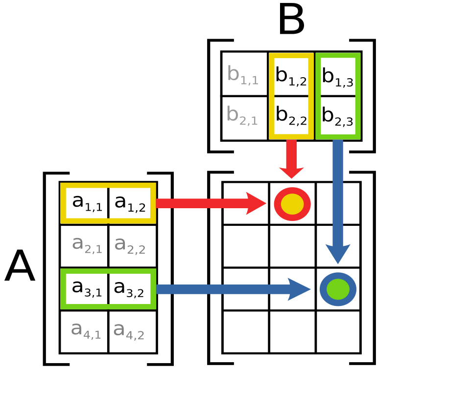</a> Lakeworks · <a href="http://creativecommons.org/licenses/by-sa/3.0/">CC BY-SA 3.0</a> · <a href="https://commons.wikimedia.org/wiki/File:Matrix_multiplication_diagram_2.svg">Wikimedia Commons</a></td>
<td valign="top">

#### 🧮 AlphaTensor discovers faster matrix multiplication algorithms
**October 5, 2022** · 🧮 Algorithms (matrix multiplication) · *AlphaTensor (DeepMind)*

DeepMind recast the search for matrix multiplication algorithms as a single-player game of decomposing a 3D tensor, and trained an AlphaZero-style agent to play it. AlphaTensor found a way to multiply 4x4 matrices in mod-2 arithmetic with 47 multiplications, beating the 49 from applying Strassen's 1969 method twice, and cut 4x5-by-5x5 products from 80 to 76 multiplications. It also found hardware-tailored algorithms that ran 10-20% faster on Nvidia V100 GPUs and Google TPUs.

**Why it matters:** This was the first improvement on Strassen's two-level algorithm in a finite field in over 50 years, and it was found by an AI, showing AI could discover new provably correct algorithms in a fundamental area of math.

**Sources:** [Discovering novel algorithms with AlphaTensor](https://deepmind.google/discover/blog/discovering-novel-algorithms-with-alphatensor/) (Google DeepMind) · [Discovering faster matrix multiplication algorithms with reinforcement learning (Fawzi et al., Nature 610, 47-53)](https://www.ncbi.nlm.nih.gov/pmc/articles/PMC9534758/) (Nature (via PubMed Central)) · [AlphaTensor](https://en.wikipedia.org/wiki/AlphaTensor) (Wikipedia)

</td></tr></table>

<table><tr>
<td width="300" valign="top" align="center"><i>No freely licensed image yet</i></td>
<td valign="top">

#### ♟️ Meta's Cicero reaches human-level play in Diplomacy
**November 22, 2022** · ♟️ Diplomacy · *Cicero (Meta AI, FAIR Diplomacy team)* vs. *Human players in an anonymous online webDiplomacy.net blitz league*

Meta AI's Cicero combined a dialogue language model with strategic planning so it could negotiate, form alliances and coordinate with human players in natural language. Playing anonymously in an online blitz league on webDiplomacy.net, it scored more than double the average human player's score. It also ranked in the top 10% of participants who played more than one game.

**Why it matters:** This was the first AI to reach strong human-level play in a game that depends on persuasion, trust and cooperation through free-form conversation, not just moves on a board.

**Sources:** [CICERO: An AI agent that negotiates, persuades, and cooperates with people](https://ai.meta.com/blog/cicero-ai-negotiates-persuades-and-cooperates-with-people/) (Meta AI) · [Human-level play in the game of Diplomacy by combining language models with strategic reasoning (Science, 2022; doi:10.1126/science.ade9097)](https://www.mit.edu/~gfarina/2022/cicero) (Science (author page, Meta FAIR Diplomacy Team)) · [Meta's new AI can use deceit to conquer a board game world](https://www.popsci.com/technology/meta-ai-bot-diplomacy/) (Popular Science)

</td></tr></table>

<table><tr>
<td width="300" valign="top" align="center"><i>No freely licensed image yet</i></td>
<td valign="top">

#### 💬 ChatGPT launches and becomes the fastest-growing consumer app
**November 30, 2022** · 💬 Conversational AI · *ChatGPT (OpenAI), fine-tuned from GPT-3.5*

OpenAI released ChatGPT as a free research preview: a chatbot fine-tuned from a GPT-3.5 model using reinforcement learning from human feedback (RLHF). It reportedly passed one million users within five days. A UBS analysis of Similarweb data estimated about 100 million monthly active users by January 2023, which it called the fastest ramp of any consumer internet app.

**Why it matters:** ChatGPT brought capable large language models to the general public almost overnight and started the global generative-AI race among companies and governments.

**Sources:** [Introducing ChatGPT](https://openai.com/index/chatgpt/) (OpenAI) · [ChatGPT](https://en.wikipedia.org/wiki/ChatGPT) (Wikipedia) · [Euronews report on ChatGPT's estimated 100 million users](https://www.euronews.com/2023/02/02/openai-chatgpt) (Euronews)

</td></tr></table>

<table><tr>
<td width="300" valign="top" align="center"><i>No freely licensed image yet</i></td>
<td valign="top">

#### 💬 GPT-4 scores around the top 10% on a simulated bar exam
**March 14, 2023** · 💬 Professional exams (law) · *GPT-4 (OpenAI)*

OpenAI released GPT-4 on 14 March 2023 with a technical report saying the model passed a simulated Uniform Bar Exam with a score around the top 10% of test takers (a reported scaled score of 298), alongside strong results on many other academic and professional exams. The bar exam evaluation was run with OpenAI's collaborators Casetext and Stanford CodeX. A 2024 peer-reviewed re-analysis by MIT's Eric Martínez concluded the 90th-percentile figure was inflated: it rested on February Illinois data skewed toward repeat takers. Against a July exam the estimate fell below the 69th percentile overall, to about the 62nd among first-time takers and about the 48th among those who passed, with essays weaker still.

**Why it matters:** The moment a general-purpose chatbot was credibly reported to pass a professional licensing exam, which made "AI vs. human professionals" a mainstream question, even though the headline percentile was later shown to be overstated.

**Sources:** [GPT-4 Technical Report (arXiv:2303.08774)](https://arxiv.org/abs/2303.08774) (OpenAI / arXiv) · [Re-evaluating GPT-4's bar exam performance](https://link.springer.com/article/10.1007/s10506-024-09396-9) (Artificial Intelligence and Law (Springer), Eric Martínez) · [GPT-4 didn't ace the bar exam after all, MIT research suggests](https://livescience.com/technology/artificial-intelligence/gpt-4-didnt-ace-the-bar-exam-after-all-mit-research-suggests-it-barely-passed) (Live Science)

</td></tr></table>

<table><tr>
<td width="300" valign="top" align="center"><i>No freely licensed image yet</i></td>
<td valign="top">

#### 🧮 AlphaDev discovers faster sorting routines merged into LLVM's libc++
**June 7, 2023** · 🧮 Algorithms (sorting) · *AlphaDev (Google DeepMind)*

Google DeepMind's AlphaDev treated writing low-level assembly as a single-player game and used reinforcement learning (building on AlphaZero) to search for shorter, faster routines for sorting very short sequences. The resulting routines were translated into C++ and accepted into LLVM's standard C++ library, libc++. DeepMind reported they were up to 70% faster for short sequences and about 1.7% faster for sequences over 250,000 elements, and called it the first change to that part of the library in more than a decade. AlphaDev also found a hashing routine about 30% faster for 9-16 byte inputs, released in Google's Abseil library.

**Why it matters:** An algorithm found by reinforcement learning, rather than written by people, shipped in one of the most widely used software libraries in the world.

**Sources:** [AlphaDev discovers faster sorting algorithms](https://deepmind.google/discover/blog/alphadev-discovers-faster-sorting-algorithms/) (Google DeepMind) · [Faster sorting algorithms discovered using deep reinforcement learning](https://www.nature.com/articles/s41586-023-06004-9) (Nature) · [AlphaDev](https://en.wikipedia.org/wiki/AlphaDev) (Wikipedia)

</td></tr></table>

<table><tr>
<td width="300" valign="top" align="center"><i>No freely licensed image yet</i></td>
<td valign="top">

#### 🤖 Swift autonomous drone beats human drone-racing champions
**August 30, 2023** · 🤖 Drone racing · *Swift (University of Zurich Robotics and Perception Group, with Intel Labs)* vs. *Alex Vanover, Thomas Bitmatta and Marvin Schaepper, champion FPV drone-racing pilots*

Swift, a quadcopter from the University of Zurich's Robotics and Perception Group with Intel Labs, was trained mostly in simulation with deep reinforcement learning, then flew using only onboard sensors (camera and inertial measurements). In head-to-head races on a purpose-built track in a hangar at Dübendorf airport near Zurich, it won 5 of 9 races against Alex Vanover (2019 Drone Racing League champion), 4 of 7 against Thomas Bitmatta (2019 MultiGP champion) and 6 of 9 against three-time Swiss champion Marvin Schaepper. That is 15 of 25 races overall. It also set the fastest race time, about half a second ahead of the best human.

**Why it matters:** A rare case of a learned controller beating world-class humans in a physical, real-world sport rather than a board game or video game.

**Sources:** [Champion-level drone racing using deep reinforcement learning (Nature 620, 982-987; DOI 10.1038/s41586-023-06419-4)](https://ideas.repec.org/a/nat/nature/v620y2023i7976d10.1038_s41586-023-06419-4.html) (Nature, via RePEc/IDEAS record) · [Drone race (University of Zurich news release)](https://news.uzh.ch/en/articles/media/2023/Drone-race.html) (University of Zurich) · [AI drone soars to victory in races against human champions](https://the-decoder.com/ai-drone-soars-to-victory-in-races-against-human-champions/) (The Decoder)

</td></tr></table>

<table><tr>
<td width="300" valign="top" align="center"><i>No freely licensed image yet</i></td>
<td valign="top">

#### 🔬 GraphCast outperforms the leading operational 10-day weather forecast
**November 14, 2023** · 🔬 Weather forecasting · *GraphCast (Google DeepMind)*

Google DeepMind's GraphCast is a graph neural network trained on about four decades of ECMWF ERA5 reanalysis data. It produces 10-day global forecasts at 0.25° resolution in under a minute on a single TPU. Published in Science, it beat ECMWF's HRES, the gold-standard deterministic forecast, on more than 90% of 1,380 test variables and lead times, and on 99.7% of tropospheric targets. HRES takes hours on a supercomputer.

**Why it matters:** A landmark peer-reviewed case of a machine-learning model beating the world's best physics-based deterministic forecast across most medium-range targets.

**Sources:** [GraphCast: AI model for faster and more accurate global weather forecasting](https://deepmind.google/discover/blog/graphcast-ai-model-for-faster-and-more-accurate-global-weather-forecasting/) (Google DeepMind) · [Learning skillful medium-range global weather forecasting (Science, DOI 10.1126/science.adi2336)](https://www.science.org/stoken/author-tokens/ST-1550/full) (Science)

</td></tr></table>

<table><tr>
<td width="300" valign="top" align="center"><i>No freely licensed image yet</i></td>
<td valign="top">

#### 🧮 FunSearch: LLM-driven program search finds new, larger cap sets
**December 14, 2023** · 🧮 Combinatorics (cap sets) · *FunSearch (Google DeepMind)*

Google DeepMind's FunSearch pairs a pretrained code-writing language model with an automated evaluator in an evolutionary loop. The model proposes small programs, the best are kept, and they are fed back as prompts. Applied to the cap set problem, FunSearch found a cap set of size 512 in dimension 8, larger than any previously known construction. It also improved lower bounds on the asymptotic cap set capacity, and it found online bin-packing heuristics that beat standard ones. The work was published in Nature with co-author Jordan Ellenberg.

**Why it matters:** DeepMind described it as the first time a large language model was used to make a new, verifiable discovery on a challenging open problem in mathematics.

**Sources:** [FunSearch: Making new discoveries in mathematical sciences using Large Language Models](https://deepmind.google/discover/blog/funsearch-making-new-discoveries-in-mathematical-sciences-using-large-language-models) (Google DeepMind) · [Mathematical discoveries from program search with large language models](https://www.nature.com/articles/s41586-023-06924-6) (Nature) · [FunSearch](https://en.wikipedia.org/wiki/FunSearch) (Wikipedia)

</td></tr></table>

<table><tr>
<td width="300" valign="top" align="center"><i>No freely licensed image yet</i></td>
<td valign="top">

#### 🧮 AlphaGeometry solves olympiad geometry near gold-medalist level
**January 17, 2024** · 🧮 Geometry · *AlphaGeometry (Google DeepMind)*

Google DeepMind's AlphaGeometry combines a language model, which proposes auxiliary constructions, with a symbolic deduction engine. It was trained on 100 million synthetic proofs and no human demonstrations. On a benchmark of 30 IMO geometry problems from 2000-2022 it solved 25 within competition time limits. The previous best automated method (Wu's method) solved 10, and the average human gold medalist solved about 25.9.

**Why it matters:** Machine reasoning reached roughly the level of the best high-school mathematicians in one olympiad domain, a step toward the IMO "grand challenge."

**Sources:** [AlphaGeometry: An Olympiad-level AI system for geometry](https://deepmind.google/discover/blog/alphageometry-an-olympiad-level-ai-system-for-geometry/) (Google DeepMind) · [Solving olympiad geometry without human demonstrations](https://www.nature.com/articles/s41586-023-06747-5) (Nature) · [AlphaGeometry](https://en.wikipedia.org/wiki/AlphaGeometry) (Wikipedia)

</td></tr></table>

<table><tr>
<td width="300" valign="top" align="center"><i>No freely licensed image yet</i></td>
<td valign="top">

#### 🧮 AlphaProof and AlphaGeometry 2 reach silver-medal standard at IMO 2024
**July 25, 2024** · 🧮 Olympiad mathematics · *AlphaProof and AlphaGeometry 2 (Google DeepMind)* vs. *Human contestants at the 65th IMO (Bath, UK)*

Google DeepMind's AlphaProof, a reinforcement-learning system that proves statements in the Lean proof assistant, worked alongside AlphaGeometry 2 on the six problems of the 2024 International Mathematical Olympiad in Bath, UK. Together they fully solved 4 of 6 problems, including the hardest, which only five human contestants solved, for 28 of 42 points. That is the top of the silver range, one point below the gold cutoff of 29 that 58 of 609 human contestants reached. Fields Medalist Timothy Gowers and Joseph Myers scored the solutions under IMO rules.

**Why it matters:** The first time an AI system reached medal standard on the actual problems of a live IMO.

**Sources:** [AI achieves silver-medal standard solving International Mathematical Olympiad problems](https://deepmind.google/discover/blog/ai-achieves-silver-medal-standard-solving-international-mathematical-olympiad-problems/) (Google DeepMind) · [AI Reaches Silver-Medal Level at This Year's Math Olympiad](https://www.scientificamerican.com/article/ai-reaches-silver-medal-level-at-this-years-math-olympiad/) (Scientific American) · [Olympiad-level formal mathematical reasoning with reinforcement learning](https://www.nature.com/articles/s41586-025-09833-y) (Nature (2025))

</td></tr></table>

<table><tr>
<td width="300" valign="top" align="center"><i>No freely licensed image yet</i></td>
<td valign="top">

#### 🧮 OpenAI o1 introduces LLMs trained to reason at length before answering
**September 12, 2024** · 🧮 Mathematical and scientific reasoning · *OpenAI o1 (OpenAI)*

OpenAI previewed o1, a model trained with reinforcement learning to produce a long internal chain of thought before answering. Performance kept improving with both more training and more "thinking" time at inference. OpenAI reported that o1 averaged 74% on the 2024 AIME with one sample (83% with 64-sample consensus), against about 12% for GPT-4o. It was the first model to beat recruited PhD experts on the GPQA Diamond science benchmark, and it reached the 89th percentile on Codeforces. A variant entered under IOI 2024 contest rules scored at the 49th percentile.

**Why it matters:** Launched the "reasoning model" paradigm and test-time compute scaling, which drove the jumps in AI competition math and programming results through 2025.

**Sources:** [Learning to reason with LLMs](https://openai.com/index/learning-to-reason-with-llms/) (OpenAI) · [OpenAI o1](https://en.wikipedia.org/wiki/OpenAI_o1) (Wikipedia)

</td></tr></table>

<table><tr>
<td width="300" valign="top"><a href="https://commons.wikimedia.org/wiki/File:Geoffrey_Hinton_in_2026.jpg">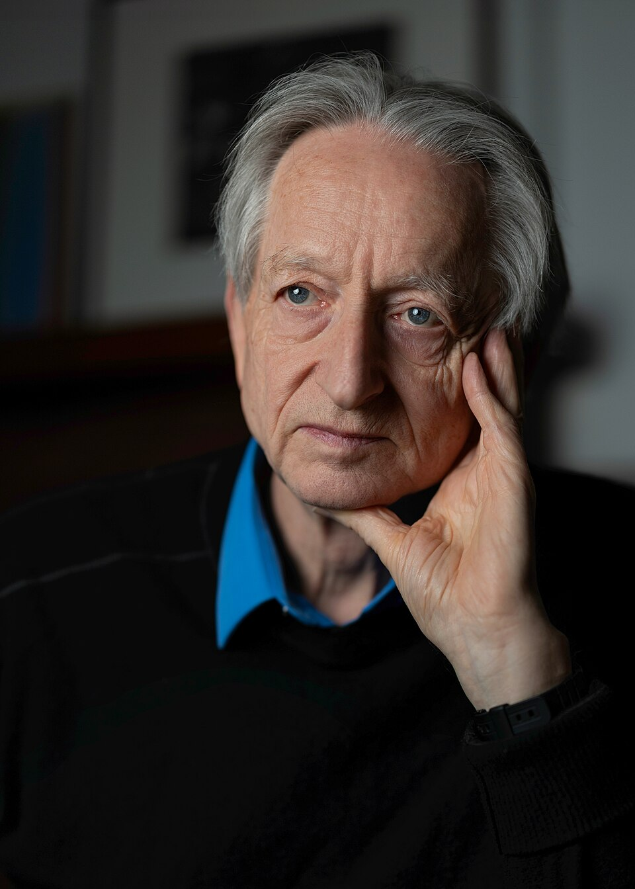</a> Cmichel67 · <a href="https://creativecommons.org/licenses/by-sa/4.0">CC BY-SA 4.0</a> · <a href="https://commons.wikimedia.org/wiki/File:Geoffrey_Hinton_in_2026.jpg">Wikimedia Commons</a></td>
<td valign="top">

#### 🔬 Nobel Prize in Physics honors Hopfield and Hinton for neural networks
**October 8, 2024** · 🔬 Machine learning (recognition) · *Hopfield network; Boltzmann machine*

The Royal Swedish Academy of Sciences awarded the 2024 Nobel Prize in Physics jointly to John Hopfield (Princeton) and Geoffrey Hinton (Toronto) "for foundational discoveries and inventions that enable machine learning with artificial neural networks." The committee cited Hopfield's associative-memory network, which stores and reconstructs patterns using ideas from the physics of atomic spins, and Hinton's Boltzmann machine, built on it, which learns to recognize characteristic features in data.

**Why it matters:** Science's most prestigious prize recognized artificial neural networks, the basis of modern AI, as foundational science.

**Sources:** [Press release: The Nobel Prize in Physics 2024](https://www.nobelprize.org/prizes/physics/2024/press-release/) (Nobel Prize Outreach / Royal Swedish Academy of Sciences) · [The discovery of tools key to machine learning wins the 2024 physics Nobel](https://sciencenews.org/article/nobel-physics-2024-machine-learning) (Science News) · [Geoffrey Hinton Awarded the 2024 Nobel Prize in Physics](https://www.acm.org/articles/bulletins/2024/october/geoffrey-hinton-nobel-prize) (ACM)

</td></tr></table>

<table><tr>
<td width="300" valign="top"> Duncan.Hull · <a href="https://creativecommons.org/licenses/by-sa/4.0">CC BY-SA 4.0</a> · <a href="https://commons.wikimedia.org/wiki/File:Demis_Hassabis_Royal_Society.jpg">Wikimedia Commons</a></td>
<td valign="top">

#### 🔬 Nobel Prize in Chemistry honors AlphaFold's Hassabis and Jumper, with Baker
**October 9, 2024** · 🔬 Protein structure prediction · *AlphaFold 2 (Google DeepMind); computational protein design (Baker lab, University of Washington)*

The 2024 Nobel Prize in Chemistry went half to David Baker "for computational protein design" and half jointly to Google DeepMind's Demis Hassabis and John Jumper "for protein structure prediction." The Academy highlighted AlphaFold2 (2020), which has been used to predict the structures of nearly all of the roughly 200 million proteins researchers have identified, and has been used by more than two million people in 190 countries.

**Why it matters:** The first Nobel Prize awarded for building an AI system, which confirmed that AlphaFold had solved a decades-old scientific problem.

**Sources:** [The Nobel Prize in Chemistry 2024 (press release, PDF)](https://kva.se/app/uploads/2024/11/press_ke_en_24.pdf) (Royal Swedish Academy of Sciences) · [Press release: The Nobel Prize in Chemistry 2024](https://www.nobelprize.org/prizes/chemistry/2024/press-release/) (Nobel Prize Outreach) · [Work on protein structure and design wins the 2024 chemistry Nobel](https://sciencenews.org/article/nobel-prize-chemistry-2024-proteins) (Science News)

</td></tr></table>

<table><tr>
<td width="300" valign="top" align="center"><i>No freely licensed image yet</i></td>
<td valign="top">

#### 🧮 OpenAI o3 scores 75.7% to 87.5% on the ARC-AGI-1 reasoning benchmark
**December 20, 2024** · 🧮 Abstract reasoning (ARC-AGI) · *OpenAI o3 (pre-release version, OpenAI)*

On 20 December 2024 the ARC Prize Foundation verified that a pre-release OpenAI o3 scored 75.7% on the 100-task ARC-AGI-1 semi-private evaluation at a compute budget within the public leaderboard's limits, and 87.5% with about 172 times more compute. The larger run cost roughly $4,560 per task. ARC-AGI was built by François Chollet as grid puzzles that are easy for people but had long resisted LLMs.

**Why it matters:** A benchmark designed to resist memorization and scale fell sharply to a reasoning model, though its creators stressed that this was not AGI.

**Sources:** [OpenAI o3 Breakthrough High Score on ARC-AGI-Pub](https://arcprize.org/blog/oai-o3-pub-breakthrough) (ARC Prize Foundation) · [OpenAI o3](https://en.wikipedia.org/wiki/OpenAI_o3) (Wikipedia)

</td></tr></table>

<table><tr>
<td width="300" valign="top"><a href="https://commons.wikimedia.org/wiki/File:Alan_Turing_(1912-1954)_in_1936_at_Princeton_University.jpg">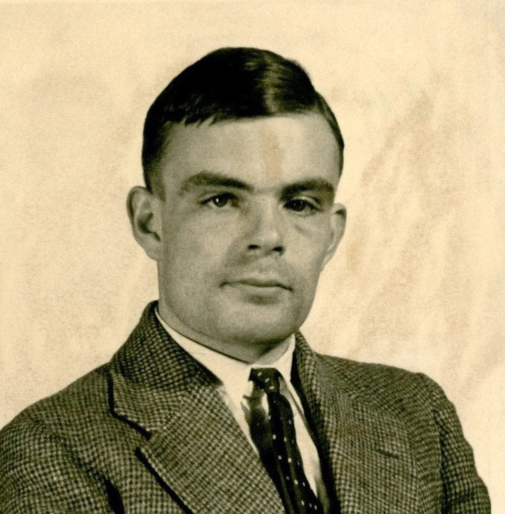</a> Unknown photographer · Public domain · <a href="https://commons.wikimedia.org/wiki/File:Alan_Turing_(1912-1954)_in_1936_at_Princeton_University.jpg">Wikimedia Commons</a></td>
<td valign="top">

#### 💬 GPT-4.5 judged human more often than real humans in a Turing test
**March 31, 2025** · 💬 Turing test · *GPT-4.5 (OpenAI), tested by Jones and Bergen (UC San Diego)* vs. *Human witnesses and interrogators in a randomized three-party Turing test*

UC San Diego researchers Cameron Jones and Benjamin Bergen ran randomized, pre-registered three-party Turing tests. Each interrogator chatted for five minutes at once with a real person and an AI, then chose which was human. Prompted to adopt a humanlike persona, GPT-4.5 was picked as the human 73% of the time, significantly more often than the real humans it was paired with. LLaMa-3.1-405B was picked 56% of the time (not significantly different from humans), while the baselines ELIZA and GPT-4o were picked 23% and 21%.

**Why it matters:** The authors presented it as the first empirical evidence that an AI system passes a standard three-party version of Turing's imitation game.

**Sources:** [Large Language Models Pass the Turing Test (arXiv:2503.23674)](https://arxiv.org/abs/2503.23674) (arXiv (Jones and Bergen)) · [Turing test](https://en.wikipedia.org/wiki/Turing_test) (Wikipedia)

</td></tr></table>

<table><tr>
<td width="300" valign="top" align="center"><i>No freely licensed image yet</i></td>
<td valign="top">

#### 🧮 AlphaEvolve beats Strassen for 4x4 complex matrices, advances open problems
**May 14, 2025** · 🧮 Algorithms and combinatorics · *AlphaEvolve (Google DeepMind), powered by Gemini*

Google DeepMind's AlphaEvolve is an evolutionary coding agent: Gemini models propose code changes and automated evaluators score them. It found a way to multiply two 4x4 complex-valued matrices with 48 scalar multiplications, the first improvement in that setting over the 49 from applying Strassen's 1969 algorithm recursively. On more than 50 open problems in analysis, geometry, combinatorics and number theory, it matched the best known results in about 75% of cases and improved them in about 20%. One example is a new lower bound of 593 for the kissing number in 11 dimensions. Inside Google, it found a data-center scheduling heuristic that recovers about 0.7% of fleet-wide compute.

**Why it matters:** An LLM-driven discovery system improved results that had stood for decades, including a 56-year-old benchmark in fast matrix multiplication.

**Sources:** [AlphaEvolve: A Gemini-powered coding agent for designing advanced algorithms](https://deepmind.google/blog/alphaevolve-a-gemini-powered-coding-agent-for-designing-advanced-algorithms/) (Google DeepMind) · [AlphaEvolve: A coding agent for scientific and algorithmic discovery (arXiv:2506.13131)](https://arxiv.org/abs/2506.13131) (arXiv (Novikov et al.)) · [AlphaEvolve](https://en.wikipedia.org/wiki/AlphaEvolve) (Wikipedia)

</td></tr></table>

<table><tr>
<td width="300" valign="top" align="center"><i>No freely licensed image yet</i></td>
<td valign="top">

#### 🧮 OpenAI model takes 2nd at AtCoder World Tour Finals Heuristic, behind Psyho
**July 16, 2025** · 🧮 Competitive programming (heuristic optimization) · *Unreleased OpenAI model/agent (OpenAI also sponsored the event)* vs. *Przemysław "Psyho" Dębiak and the other human finalists*

At the AtCoder World Tour Finals 2025 Heuristic contest in Tokyo, a ten-hour optimization contest on 16 July 2025, an OpenAI system competed alongside the world's top heuristic programmers. It finished second. Polish programmer Przemysław "Psyho" Dębiak won, with a lead that grew from about 5.5% to a final margin of about 9.5% in score. Afterwards he posted "Humanity has won (so far)!"

**Why it matters:** AI placed ahead of all but one of the world's elite humans in a long-horizon optimization contest, and it was widely seen as one of the last times a human would win such a duel.

**Sources:** [AtCoder World Tour Finals 2025 Heuristic (contest page)](https://atcoder.jp/contests/awtf2025heuristic) (AtCoder) · ['Humanity has won (so far)': Meet the world's best programmer who beat AI and ChatGPT](https://euronews.com/next/2025/07/22/humanity-has-won-so-far-meet-the-worlds-best-programmer-who-beat-ai-and-chatgpt) (Euronews) · [AI loses in coding duel: humans win after ten hours](https://heise.de/-10497998) (heise online)

</td></tr></table>

<table><tr>
<td width="300" valign="top" align="center"><i>No freely licensed image yet</i></td>
<td valign="top">

#### 🧮 Google DeepMind and OpenAI models reach gold-medal level at IMO 2025
**July 21, 2025** · 🧮 Olympiad mathematics · *Gemini Deep Think, advanced version (Google DeepMind); experimental reasoning model (OpenAI)* vs. *Human contestants at the 66th IMO*

At the 66th International Mathematical Olympiad in Queensland, Australia, an advanced version of Google DeepMind's Gemini Deep Think fully solved 5 of 6 problems for 35 of 42 points. It wrote natural-language proofs directly from the official problems within the 4.5-hour session limits. IMO coordinators graded and certified the result, and IMO President Gregor Dolinar confirmed the "much-desired milestone." An experimental OpenAI reasoning model also scored 35 under contest conditions, graded by three former IMO medalists rather than by the IMO. For comparison, 67 of about 630 human contestants earned gold and five scored a perfect 42.

**Why it matters:** General-purpose language models, working in plain English without formal tools, crossed the IMO gold threshold a year after the formal-methods silver.

**Sources:** [Advanced version of Gemini with Deep Think officially achieves gold-medal standard at the International Mathematical Olympiad](https://deepmind.google/blog/advanced-version-of-gemini-with-deep-think-officially-achieves-gold-medal-standard-at-the-international-mathematical-olympiad/) (Google DeepMind) · [Google and OpenAI's AI models win milestone gold at global math competition (Reuters)](https://www.cp24.com/news/world/2025/07/21/google-and-openais-ai-models-win-milestone-gold-at-global-math-competition/) (Reuters, via CP24) · [Humans beat AI gold-level score at top maths contest (AFP)](https://citizen.digital/article/humans-beat-ai-gold-level-score-at-top-maths-contest) (AFP, via Citizen Digital) · [OpenAI claims a breakthrough in LLM reasoning on complex math problems](https://the-decoder.com/openai-claims-a-breakthrough-in-llm-reasoning-on-complex-math-problems/) (The Decoder)

</td></tr></table>

<table><tr>
<td width="300" valign="top" align="center"><i>No freely licensed image yet</i></td>
<td valign="top">

#### 🧮 OpenAI reasoning models achieve gold-medal score at IOI 2025
**August 2025** · 🧮 Competitive programming (olympiad) · *Ensemble of OpenAI general-purpose reasoning models* vs. *About 330 human contestants at IOI 2025*

At the 2025 International Olympiad in Informatics, hosted in Sucre, Bolivia (27 July to 3 August), OpenAI entered an ensemble of general-purpose reasoning models in the online AI track. The track had the same rules as the students: five hours per contest day, at most 50 submissions per problem and no internet. Its score was at gold-medal level and would have ranked sixth among about 330 human contestants, the best of any AI entry. That was the 98th percentile, up from the 49th a year earlier. No model was trained specifically for the IOI, and the strongest one was the model behind OpenAI's IMO gold.

ℹ️ **Self-reported:** announced by the developers; not yet independently confirmed.

**Why it matters:** AI moved from mid-pack to near the very top of the world's premier high-school programming olympiad in one year.

**Sources:** [OpenAI's AI system wins a gold medal-level score at the International Olympiad in Informatics 2025](https://the-decoder.com/openais-ai-system-wins-a-gold-medal-level-score-at-the-international-olympiad-in-informatics-2025/) (The Decoder) · [OpenAI KI: Goldmedaille - Logikmodell erzielt Spitzenplatz beim IOI 2025](https://www.notebookcheck.com/OpenAI-KI-Goldmedaille-Logikmodell-erzielt-Spitzenplatz-beim-IOI-2025.1086200.0.html) (Notebookcheck) · [International Olympiad in Informatics](https://en.wikipedia.org/wiki/International_Olympiad_in_Informatics) (Wikipedia)

</td></tr></table>

<table><tr>
<td width="300" valign="top" align="center"><i>No freely licensed image yet</i></td>
<td valign="top">

#### 🧮 AI solves 12/12 (OpenAI) and 10/12 (Gemini) at the ICPC World Finals
**September 4, 2025** · 🧮 Competitive programming (collegiate) · *OpenAI (GPT-5 + experimental reasoning model); Google DeepMind (Gemini 2.5 Deep Think)* vs. *139 university teams at the 2025 ICPC World Finals*

At the 2025 ICPC World Finals in Baku, Azerbaijan, AI systems tackled the same 12 problems as 139 university teams in a supervised AI track under the same five-hour rules. OpenAI's ensemble, GPT-5 plus an experimental reasoning model, solved all 12: 11 on the first submission, and the hardest after nine attempts. That would have placed first, ahead of the best human team's 11. Google DeepMind's Gemini 2.5 Deep Think solved 10, which would have ranked second. It also cracked one problem that no university team solved.

**Why it matters:** AI outscored every human team at the world's most prestigious university programming contest.

**Sources:** [Gemini achieves gold-medal level at the International Collegiate Programming Contest World Finals](https://deepmind.google/blog/gemini-achieves-gold-medal-level-at-the-international-collegiate-programming-contest-world-finals/) (Google DeepMind) · [OpenAI and DeepMind Top World's Biggest Coding Contest](https://www.techrepublic.com/article/openai-deepmind-icpc-2025-results/) (TechRepublic) · [OpenAI outperforms humans and Google at the world's top collegiate programming contest](https://the-decoder.com/openai-outperforms-humans-and-google-at-the-worlds-top-collegiate-programming-contest/) (The Decoder) · [ICPC World Finals 2025 standings](https://www.cphof.org/standings/icpc/2025) (Competitive Programming Hall of Fame)

</td></tr></table>

<table><tr>
<td width="300" valign="top"><a href="https://commons.wikimedia.org/wiki/File:Erdos_budapest_fall_1992.jpg">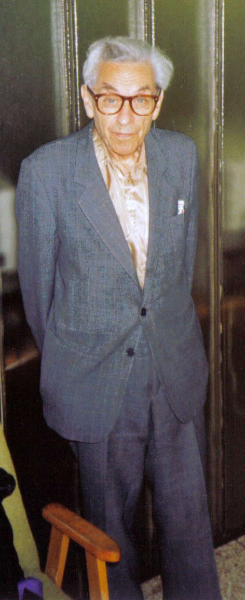</a> Kmhkmh · <a href="https://creativecommons.org/licenses/by/3.0">CC BY 3.0</a> · <a href="https://commons.wikimedia.org/wiki/File:Erdos_budapest_fall_1992.jpg">Wikimedia Commons</a></td>
<td valign="top">

#### 🧮 Harmonic's Aristotle autonomously proves a version of Erdős problem #124
**November 2025** · 🧮 Number theory (Erdős problems) · *Aristotle (Harmonic), run by Boris Alexeev*

In late November 2025, mathematician Boris Alexeev ran Harmonic's Aristotle prover in autonomous mode on formal statements of open problems from Thomas Bloom's erdosproblems.com database. Aristotle returned a Lean-verified proof of problem #124 as Erdős had posed it in two 1997 papers. It was a short proof, and the problem had sat on the site as open. The episode came a month after an overclaim: in October, OpenAI staff said GPT-5 had "found solutions to 10 previously unsolved Erdős problems," but it had actually found existing papers that already solved them. Bloom called the claim "a dramatic misrepresentation."

**Why it matters:** Among the first cases of an AI system independently producing a new, machine-checked solution to a problem listed as open on the Erdős database, but on an easier variant rather than a celebrated hard problem.

**Sources:** [Erdős Problem #124](https://www.erdosproblems.com/124) (erdosproblems.com (Thomas Bloom)) · [Formalization of Erdős problems (guest post by Boris Alexeev)](https://xenaproject.wordpress.com/2025/12/05/formalization-of-erdos-problems) (Xena Project blog (Kevin Buzzard)) · [OpenAI's 'embarrassing' math](https://techcrunch.com/2025/10/19/openais-embarrassing-math/) (TechCrunch) · [Why the Legendary Erdős Problems Are Falling to AI](https://www.quantamagazine.org/why-the-legendary-erdos-problems-are-falling-to-ai-20260803/) (Quanta Magazine)

</td></tr></table>

<table><tr>
<td width="300" valign="top" align="center"><i>No freely licensed image yet</i></td>
<td valign="top">

#### 🧮 GPT-5.2 Pro and Aristotle resolve Erdős problem #728 almost autonomously
**January 2026** · 🧮 Number theory · *GPT-5.2 Pro (OpenAI) with Aristotle (Harmonic) for Lean formalization*

In early January 2026 amateur Kevin Barreto prompted OpenAI's GPT-5.2 Pro to attack Erdős problem #728, a question about when products of factorials divide other factorials. The model produced an argument that was then formalized and machine-checked in Lean using Harmonic's Aristotle system, and no prior solution was found in the literature. Terence Tao described the problem as solved "more or less autonomously" by AI, and a write-up of the Lean proof was posted to arXiv on 12 January.

**Why it matters:** Widely regarded as the first open Erdős problem resolved essentially autonomously by AI with a formally verified proof, kicking off a year in which AI systems resolved dozens of such problems.

**Sources:** [Resolution of Erdős Problem #728: a writeup of Aristotle's Lean proof](https://arxiv.org/abs/2601.07421) (arXiv (Nat Sothanaphan)) · [Terence Tao on Erdős problem #728 (Mathstodon post)](https://mathstodon.xyz/@tao/115855845720777387) (Mathstodon (Terence Tao)) · [Terence Tao says GPT-5.2 Pro cracked an Erdős problem, but warns the win says more about speed than difficulty](https://the-decoder.com/terence-tao-says-gpt-5-2-pro-cracked-an-erdos-problem-but-warns-the-win-says-more-about-speed-than-difficulty/) (The Decoder) · [Why the Legendary Erdős Problems Are Falling to AI](https://www.quantamagazine.org/why-the-legendary-erdos-problems-are-falling-to-ai-20260803/) (Quanta Magazine) · [AI contributions to Erdős problems (wiki)](https://github.com/teorth/erdosproblems/wiki/AI-contributions-to-Erd%C5%91s-problems) (GitHub (teorth/erdosproblems))

</td></tr></table>

<table><tr>
<td width="300" valign="top" align="center"><i>No freely licensed image yet</i></td>
<td valign="top">

#### 🤖 Humanoid robot runs a half marathon faster than the human world record
**April 19, 2026** · 🤖 Humanoid locomotion · *Lightning humanoid robot (Honor)*

At the Beijing E-Town Humanoid Robot Half Marathon on 19 April 2026, a bipedal humanoid called Lightning, built by smartphone maker Honor, won the 21 km race in 50 minutes 26 seconds. That was roughly seven minutes quicker than the men's human world record for the distance, while the winning robot in the inaugural 2025 race had needed more than two hours. Robots ran on a course parallel to the human runners, and several fell or veered off course. Race rules allowed both autonomous and remote-controlled robots, and Honor did not say which mode Lightning used.

**Why it matters:** The first time a humanoid robot beat the best human time over a long-distance running event, marking a dramatic one-year jump in legged-robot speed and endurance.

**Sources:** [Humanoid robot beats human half-marathon world record in Beijing](https://www.cbsnews.com/news/humanoid-robot-half-marathon-beijing-human-world-record/) (CBS News) · ['New era': Humanoid robot outruns humans in Beijing half-marathon, beats world record](https://www.france24.com/en/technology/20260419-new-era-humanoid-robot-outruns-humans-in-beijing-half-marathon-beats-world-record) (France 24 (AFP)) · [A Robot Broke the Half-Marathon World Record. What Comes Next?](https://news.syr.edu/2026/04/22/humanoid-robot-half-marathon-world-record/) (Syracuse University News)

</td></tr></table>

<table><tr>
<td width="300" valign="top"><a href="https://commons.wikimedia.org/wiki/File:Moser_spindle.svg">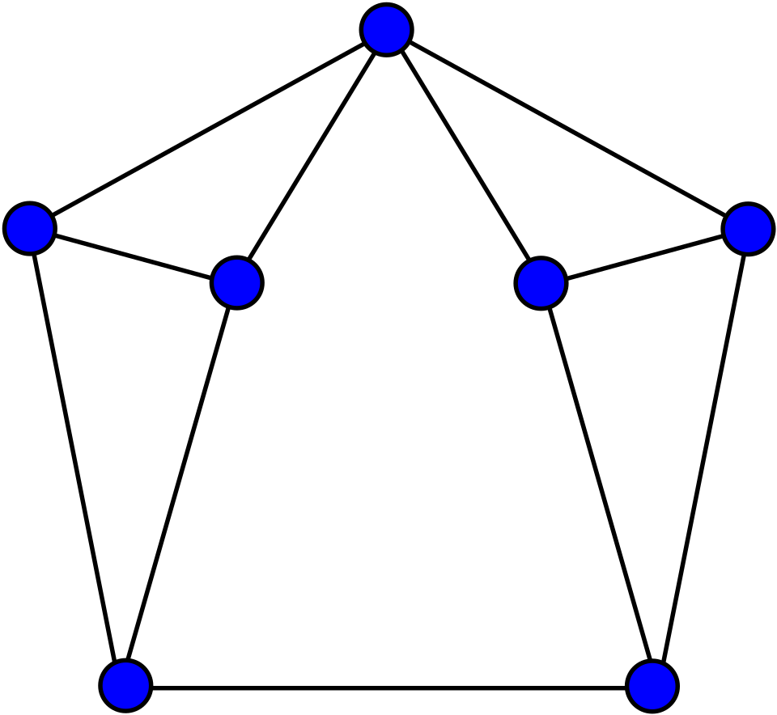</a> Koko90 · <a href="https://creativecommons.org/licenses/by-sa/3.0">CC BY-SA 3.0</a> · <a href="https://commons.wikimedia.org/wiki/File:Moser_spindle.svg">Wikimedia Commons</a></td>
<td valign="top">

#### 🧮 OpenAI model disproves Erdős's 80-year-old unit distance conjecture
**May 20, 2026** · 🧮 Discrete geometry · *Unnamed internal general-purpose reasoning model (OpenAI)*

OpenAI announced that an unreleased general-purpose reasoning model had refuted Erdős's 1946 conjecture that n points in the plane can have only slightly more than linearly many pairs at distance exactly one. Using ideas from algebraic number theory, it built point sets from a higher-dimensional lattice projected into the plane that achieve at least n^(1+δ) unit distances for a fixed δ > 0. Nine outside mathematicians, including Noga Alon, Tim Gowers and Melanie Matchett Wood, checked the argument and wrote a companion paper, and Will Sawin quickly made the exponent explicit (δ = 0.014, later improved).

**Why it matters:** Experts called it the first AI-generated proof to come close to top-journal standard, and the first time AI autonomously settled a famous, long-studied conjecture rather than an obscure one.

**Sources:** [An OpenAI model has disproved a central conjecture in discrete geometry](https://openai.com/index/model-disproves-discrete-geometry-conjecture/) (OpenAI) · [Remarks on the disproof of the unit distance conjecture](https://cdn.openai.com/pdf/74c24085-19b0-4534-9c90-465b8e29ad73/unit-distance-remarks.pdf) (OpenAI (Alon, Bloom, Gowers, Litt, Sawin, Shankar, Tsimerman, Wang, Wood)) · [AI just solved an 80-year-old 'Erdős problem,' and mathematicians are amazed](https://www.scientificamerican.com/article/ai-just-solved-an-80-year-old-erdos-problem-and-mathematicians-are-amazed/) (Scientific American) · [Amazing: Erdős' Unit Distance Problem was Disproved! It was achieved by AI!](https://gilkalai.wordpress.com/2026/05/21/amazing-erdos-unit-distance-problem-was-disproved-it-was-achieved-by-ai/) (Combinatorics and more (Gil Kalai's blog)) · [Why the Legendary Erdős Problems Are Falling to AI](https://www.quantamagazine.org/why-the-legendary-erdos-problems-are-falling-to-ai-20260803/) (Quanta Magazine)

</td></tr></table>

<table><tr>
<td width="300" valign="top" align="center"><i>No freely licensed image yet</i></td>
<td valign="top">

#### 🧮 AI systems earn perfect 42/42 scores at the 2026 Math Olympiad
**July 2026** · 🧮 Math olympiad (IMO) · *Celia (Huawei); dots-note-3.0 (Xiaohongshu/RedNote)*

At the 67th International Mathematical Olympiad in Shanghai (papers sat 15-16 July 2026), Huawei's Celia and Xiaohongshu's dots-note-3.0 were reported to score a full 42 out of 42. Labs received the problems only after the human exam ended, had to submit within a time limit, and Xiaohongshu says its solutions were graded by IMO organizers with no human intervention allowed. Only 7 of the 666 human contestants achieved full marks; several other frontier models also reached 42/42 in unofficial tests.

ℹ️ **Self-reported:** announced by the developers; not yet independently confirmed.

**Why it matters:** One year after AI first reached IMO gold level, AI matched the very best human performance with reportedly the first perfect scores under the olympiad's official grading channel.

**Sources:** [AI catches up with humans to score 100% at top maths contest](https://www.france24.com/en/live-news/20260723-ai-catches-up-with-humans-to-score-100-at-top-maths-contest) (France 24 (AFP)) · [Xiaohongshu achieves significant AI milestone](https://global.chinadaily.com.cn/a/202607/24/WS6a62b7eda310986e2b4670a1.html) (China Daily) · [AI catches up with humans to score 100% at top math contest](https://techxplore.com/news/2026-07-ai-humans-score-math-contest.html) (Tech Xplore (AFP)) · [IMO 2026 results](https://bmos.ukmt.org.uk/news/20260719-00-imoresults.shtml) (UK Mathematics Trust)

</td></tr></table>

<table><tr>
<td width="300" valign="top" align="center"><i>No freely licensed image yet</i></td>
<td valign="top">

#### 🧮 OpenAI's Astra model claims ten long-open math results, incl. a non-sofic group
**August 1, 2026** · 🧮 Group theory / combinatorics / TCS · *Astra, internal pre-release model (OpenAI); later released as GPT-6 Astra*

OpenAI announced that an internal version of its next model, Astra, had produced ten new results on problems each open for at least a decade, released with a 249-page manuscript and a Lean 4 certificate for every proof. The headline item was the first construction of a non-sofic group, settling the question of whether all groups are sofic (open since soficity was introduced around 1999). Others included a disproof of Connes's rigidity conjecture, Ehrhart's volume conjecture, improved sphere-packing and code bounds, and three more Erdős problems (#146, #180, #183). Some mathematicians questioned how much the work owed to earlier papers and to their own ChatGPT conversations; as of October 2026 no one had publicly challenged the proofs' correctness.

ℹ️ **Self-reported:** announced by the developers; not yet independently confirmed.

**Why it matters:** The largest batch of machine-checked AI solutions to long-open problems announced at once, headlined by the first known non-sofic group.

**Sources:** [Ten advances in mathematics and theoretical computer science](https://openai.com/index/ten-advances-in-mathematics/) (OpenAI) · [Ten proofs manuscript](https://cdn.openai.com/pdf/ten-proofs-oai.pdf) (OpenAI) · [openai/ten-proofs (Lean certificates)](https://github.com/openai/ten-proofs) (GitHub) · [OpenAI says its next model, Astra, has solved ten open problems in mathematics](https://thenextweb.com/news/openai-astra-model-ten-math-proofs-non-sofic-groups) (The Next Web) · [Mathematician Andreas Thom Questions If OpenAI Used His ChatGPT Chat Data For Its Non-Sofic Groups Proof](https://officechai.com/ai/mathematician-andreas-thom-questions-if-openai-used-his-chatgpt-chat-data-for-its-non-sofic-groups-proof/) (OfficeChai)

</td></tr></table>

<table><tr>
<td width="300" valign="top" align="center"><i>No freely licensed image yet</i></td>
<td valign="top">

#### 🧮 OpenAI claims an AI proof of Navier–Stokes blowup, a Millennium Prize problem
**September 8, 2026** · 🧮 Fluid dynamics / PDE · *Unnamed internal model running ~10,000 agents (OpenAI)*

On 8 September 2026 OpenAI announced that an unreleased internal model, running many agents in parallel, had produced a proof that the 3D incompressible Navier–Stokes equations can develop a singularity in finite time from smooth initial data, in the version of the problem with a smooth external force that the official Clay statement allows. A second model formalized the argument in Lean in about 17 hours, and OpenAI said it would not claim the US$1 million prize. The Clay Mathematics Institute called the announcement exciting but said its evaluation would be slow and rigorous, and it still lists the problem as open. An October 2026 arXiv paper argued the Lean code does not faithfully match the written proof, and the announcement set off a priority dispute with researchers working on related blowup results.

⚠️ **Claim under review:** experts have not yet verified this result.

**Why it matters:** If it holds up, it is the first Millennium Prize problem resolved since Perelman's proof of the Poincaré conjecture, and the first resolved by a machine.

**Sources:** [On the Navier–Stokes Millennium Prize Problem](https://openai.com/index/navier-stokes-solution/) (OpenAI) · [Navier–Stokes Equation (Millennium Prize problem page)](https://www.claymath.org/millennium/navier-stokes-equation/) (Clay Mathematics Institute) · [AI Has Solved One of Math's $1 Million Millennium Prize Problems](https://www.quantamagazine.org/ai-has-solved-one-of-maths-1-million-millennium-prize-problems-20260908/) (Quanta Magazine) · [OpenAI's historic math solution overshadowed by credit controversy](https://www.axios.com/2026/09/08/openai-math-solution-navier-stokes-credit) (Axios) · [What OpenAI's latest controversy tells us about the future of math](https://www.technologyreview.com/2026/09/08/1143747/what-openais-latest-controversy-tells-us-about-the-future-of-math/) (MIT Technology Review) · [Navier–Stokes lost in translation: Why Lean verification of AI autoformalisation does not guarantee correct natural language proofs](https://arxiv.org/html/2610.08144v1) (arXiv (Bastounis, Circelli, Hansen)) · [Navier–Stokes priority controversy](https://en.wikipedia.org/wiki/Navier%E2%80%93Stokes_priority_controversy) (Wikipedia)

</td></tr></table>

<table><tr>
<td width="300" valign="top" align="center"><i>No freely licensed image yet</i></td>
<td valign="top">

#### ♟️ Ataraxos AI beats Stratego's greatest player, 15 wins to 1
**September 30, 2026** · ♟️ Stratego · *Ataraxos (Carnegie Mellon, MIT, NYU, Stanford)* vs. *Pim Niemeijer, four-time Stratego world champion*

Ataraxos, built by Samuel Sokota, Gabriele Farina and colleagues at Carnegie Mellon, MIT, NYU and Stanford, played a 20-game online series against Pim Niemeijer, the most decorated Stratego player in history, winning 15, losing 1 and drawing 4. The system combines self-play reinforcement learning with test-time search over hidden information and was trained in about a week on 16 H100 GPUs, under USD 8,000, a tiny fraction of the compute of DeepMind's earlier DeepNash. The work was published in Nature on 30 September 2026.

**Why it matters:** The first superhuman result in Stratego, a long-horizon game of hidden information that had been one of the last classic board games where top humans still beat AI.

**Sources:** [Scalable decision-making for games of imperfect information](https://www.nature.com/articles/s41586-026-11036-y) (Nature) · [Scalable Decision Making for Games of Imperfect Information (preprint)](https://arxiv.org/abs/2511.07312) (arXiv) · [This game-playing AI is the new champ at Stratego](https://news.mit.edu/2026/game-playing-ai-stratego-new-champ-0930) (MIT News) · [AI beats Stratego's greatest player, ending one of the last human strongholds in board games](https://the-decoder.com/ai-beats-strategos-greatest-player-ending-one-of-the-last-human-strongholds-in-board-games/) (The Decoder)

</td></tr></table>

<a href="#contents">↑ back to contents</a>

## How this repo works

- **Data:** every milestone lives in [`data/milestones.yaml`](data/milestones.yaml) (also exported as [`data/milestones.json`](data/milestones.json)). This README is generated from it.
- **Images:** only freely licensed images from Wikimedia Commons, each credited with author and license. Full list in [CREDITS.md](CREDITS.md).
- **Automation:** a weekly scheduled review adds new milestones and fixes broken links ([MAINTAINING.md](MAINTAINING.md)); GitHub Actions rebuild this page and check every link. Changes are logged in [CHANGELOG.md](CHANGELOG.md).
- **Contributing:** see [CONTRIBUTING.md](CONTRIBUTING.md) for what counts as a milestone.

Text and data: [CC BY 4.0](LICENSE.md). Images keep their own licenses (see [CREDITS.md](CREDITS.md)).
